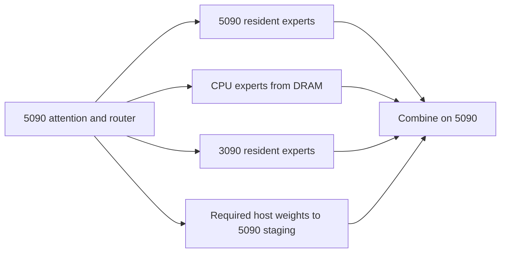
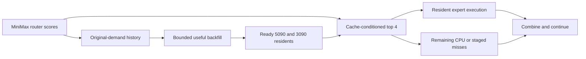
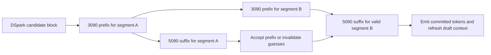

# Planning documents before consolidation — 2026-11-03

Historical snapshot only. The [current central plan](README.md) owns requirements,
status and authorized work. This file preserves the exact pre-consolidation bodies,
including already superseded instructions; none is a work order. Read a relevant
section only when tracing an earlier decision or source. Routine restart does not
require this archive. The earlier [stopped-round archive](history-2026-11-03-stopped-plan.md)
is unchanged.

Document links retain their original targets. Checkout instructions are shown as
text because their relative links originally resolved from their repository roots.

| Snapshot | Original path | SHA-256 |
|---|---|---|
| [central-plan](#snapshot-central-plan) | `/home/mdwbr/project-maya/docs/minimax-wsl/README.md` | `5d60e62ff49a60c2f3921085726d6ab3eec86372b6086b4440d36758d83ae3e5` |
| [evidence](#snapshot-evidence) | `/home/mdwbr/project-maya/docs/minimax-wsl/evidence.md` | `0917f69e1ec8fa5fe05217b4aeeaa5feff7ae28f07c9fabe175462e299289b65` |
| [proposal-1](#snapshot-proposal-1) | `/home/mdwbr/project-maya/docs/minimax-wsl/proposal-1-cooperative-experts.md` | `735f8cc2d00bacf1c846dc7ecf83183d2f21cb7337ba9f65915f08b6a013fb5c` |
| [proposal-2](#snapshot-proposal-2) | `/home/mdwbr/project-maya/docs/minimax-wsl/proposal-2-cache-aware-routing.md` | `122b786cc8d08dbe89aedd0f55351d0f7103fce64e7f9dc74666060804ef8152` |
| [proposal-3](#snapshot-proposal-3) | `/home/mdwbr/project-maya/docs/minimax-wsl/proposal-3-speculative-pipeline.md` | `a7d7131129b544b4ed49b372b3c45e005f93e135b21f1680afb5bf41754fc7b4` |
| [maya-agents](#snapshot-maya-agents) | `/home/mdwbr/project-maya/AGENTS.md` | `18ef5b2f968210e439aca6d16e76e26a38243069d89a66daaba22aa17cb63523` |
| [infernix-agents](#snapshot-infernix-agents) | `/home/mdwbr/Infernix-minimax/AGENTS.md` | `801f6e8e305044df6dbac260fea21ab8f4d03174e2fd00e5aaf4155d2b6b684b` |
| [strata-agents](#snapshot-strata-agents) | `/home/mdwbr/strata/AGENTS.md` | `6d3d53ebf86046cd16f091480c8d61ebb86df710eba16989f33c12d6c14701bd` |

<a id="snapshot-central-plan"></a>

<!-- BEGIN SNAPSHOT central-plan -->
# MiniMax M3.1 Flash on WSL2: central plan

**Execution remains paused. Revised 2026-11-03 UTC at the user's request.**
This revision authorizes documentation work, not implementation, builds, trace
collection, simulations or model runs. Resume execution only on a new user
instruction. Do not restart an old runner or continue its remaining checklist.

**Outcome of the stopped round: no demonstrated practical speed improvement.**
We started near 15 tok/s and ended near 15 tok/s. Repairs, component gains and
completed comparisons are reusable work; they do not constitute faster inference.
The broader decision between the three runtime bases remains unfinished.
The user's latest priority is to get the required system working and optimize
its residency in **Maya first**. Other-base work is deferred until that milestone.

This file alone owns current requirements, decisions, priorities and completion
across the three assigned repositories. The user's latest instructions take
precedence. The [stopped plan and complete evidence record](history-2026-11-03-stopped-plan.md)
preserves the previous plan verbatim after an archival notice. Its mandatory
cases, locked gates, repair sequences, commit authorization and launch instructions
are **superseded**, not a queue to finish. Proposal documents are technical
references; their old implementation/exit checklists do not activate work.

## Objective and current reference

**First deliver the requested working Maya configuration:** CPU/5090/3090
cooperation, cache-aware routing, optimized fully adaptive residency,
official DSpark with Fast-HSD lenience-based verification, and uncompressed HOST
storage. The later Maya/Infernix/Strata
comparison does not block this milestone. Build for one interactive
request at a time, across coding, prose, summarization/extraction, reasoning and
tool use. Generation speed remains the principal performance objective. Keep
startup, prefill and total request latency visible separately. Do not claim an
optimum or set an invented hardware ceiling.

**User decisions, 2026-11-03:** CPU/5090/3090 cooperation is a given, not a
selection question. Every candidate and delivered engine must use it, with
**cache-aware routing and fully adaptive residency**.
Optimize their implementation together; fixed residency and routing-off are
diagnostic controls, not alternative final designs. Use raw HOST storage, without
the tested lossless codec. **Maya-first supersedes the preceding comparison-first
order**; the broader base comparison is deferred, not cancelled. Reassess work
by evidence, expected benefit and remaining cost, without fixed time durations.

**Verifier decision, 2026-11-03:** use lenience-based verification that limits
excessive draft confidence. This replaces the earlier SpecCascade target-relative
cutoff as the planned default. Integration remains open; approving this plan does
not resume implementation or model runs.

**Reasoning-effort decision, 2026-11-03:** evaluate MiniMax at **high effort or
higher**. The user reports poor reasoning and general output quality below high.
Use high as the default for reasoning/quality checks and the Python/prose speed
requests; use a supported higher level when declared, and hold the level constant
within a comparison. Do not reduce effort to obtain shorter answers or a higher
reported rate. This is the MiniMax request setting, not a change to the separate
coding-agent delegation policy.

The engineering reference is the existing **Maya cooperative configuration,
roughly 15 tok/s on two short coding prompts**:

| Part | Reference to preserve |
|---|---|
| Expert execution | CPU, RTX 5090 and RTX 3090 cooperate; each executes complete expert computations |
| 5090 arithmetic | Native FP4 |
| Primary cache | 438 calibrated main residents plus eight adaptive staging slots |
| 3090 cache | 741 records, live replenishment, worker dispatch |
| Routing | A 0.05 ranking bonus for ready GPU residents; original scores determine mixture weights |
| Token speculation | Historical reference: official DSpark, grouped SpecCascade/Fast-HSD cutoff verification; window 8 and rho 0.2. Lenience is the newly selected verifier, not yet measured. |
| Other policies | Layer pipeline off; predictive prefetch off; lossless HOST compression off |
| Sampling | Temperature 1, top-p 0.95; do not lower these to inflate acceptance |

The held M-110 reference measured **379 scored emitted tokens / 25.944107 seconds
= 14.608327 tok/s**, pooling four 128-token requests after separate priming and a
completed-round suffix cutoff. The two coding tasks pooled 17.9921 and 12.2440
tok/s. An earlier trial of the same broad policy recorded 15.68 tok/s; it does not
establish a stable higher rate. These are historical generation-suffix
results, not mixed-workload or whole-request rates.
Preserve the original reasoning-effort labels on those receipts. They do not
establish high-effort quality or performance. New candidate/control measurements
must use the same high-or-higher effort; a comparison that also changes effort
cannot isolate the effect of residency or verification.

The stopped handoff records Maya execution source `d4fa863` plus later
documentation/configuration changes. Later guards were not remeasured on the
selected configuration. The checked-in [launch configuration](native-server.json)
and [runtime defaults](native-runtime.json) describe the calibrated reference,
**not an implemented profile-free adaptive or lenience default**. Do not silently change them
during this planning revision or assign the historical rate to a new binary.

Useful evidence to carry forward:

| Finding | Engineering consequence and limit |
|---|---|
| Cache-prior routing: 11.69 to 14.61 tok/s with cooperation retained | Keep as the fast starting policy; broader quality remains unresolved. |
| Native FP4 plus live helper replenishment: 13.88 to 14.94 tok/s | Retain the group. Its constituents were not isolated; do not multiply this gain by the routing gain. |
| Tested three-layer pipeline supplied no demonstrated benefit; Strata common configuration measured 14.43 tok/s | Park the tested pipeline. The common configuration was inconclusive against Maya; this does not settle the runtime-base choice. |
| CPU/helper-off pipeline cases were around 6.3 tok/s | Poor complete configurations. They also used compressed HOST storage, so they do not isolate cooperation's contribution. |
| Compressed nonresident-expert service was 26–29% slower in matched component checks | Keep raw HOST storage in the selected path. No isolated full-model compression penalty was measured. |
| Adaptive main-bank implementation exists; calibrated coding comparisons were inconclusive | Reuse it. Neither a rejection of adaptation nor evidence for operation without calibration. |
| Function checks and simulated tool round trips passed; ordinary and approximate configurations failed a small reasoning fixture | Diagnose the shared failure. This is not evidence of acceptable reasoning quality. |

Receipts: [held routing comparison](/mnt/wsl/transfer/minimax-wsl/runs/cr-20261102/held-v2/summary.json),
[FP4/helper group](/mnt/wsl/transfer/minimax-wsl/runs/r4-20261102/helper-fp4/group-qualified-summary.json),
[earlier 15.68 result](/mnt/wsl/transfer/minimax-wsl/runs/r4-20261102/queue-runtime/summary.json),
[base comparisons](/mnt/wsl/transfer/minimax-wsl/runs/bases-20261103/summary.json),
[compressed service](/mnt/wsl/transfer/minimax-wsl/runs/cr-20261102/host-allocation-diagnostic/scale-service/summary-v3.json).
A narrower improvement against a slower control cannot stand in for improving
the usable starting engine.

## Starting and resuming work

Start the primary agent in `/home/mdwbr/project-maya` on
`minimax-wsl/proposal-2`. A future explicit execution instruction can be:
"Resume the Maya-first milestone in the central MiniMax plan: get the required
cooperative, cache-aware, fully adaptive system working, optimize its measured
residency costs, and validate the actual server." The existence of this example
does not authorize execution now.

### Mandatory restart order

1. **Recover the existing Maya implementation.** Read this plan and the
   [stopped handoff](#stopped-work-handoff-2026-11-03); inspect source, branch,
   binary/configuration and actual process/resource state. Preserve all work.
   Reuse valid ownership/state tests. Build or recheck only what the relevant
   source needs; completed historical repairs are not a fresh repair campaign.
2. **Make the requested Maya configuration the working path.** Enable the existing
   primary-adaptive control while keeping prior routing, live helper, native FP4,
   worker dispatch and cooperation. Integrate the selected lenience verifier with
   official DSpark, preserving grouped target verification and correct rejection/
   continuation state. Remove dependence on
   the frozen workload profile; preserve a valid capacity-fitting initial placement.
   Keep the stage pipeline, next-layer predictive prefetch and HOST codec off.
   Verify the actual server's effective settings, allocations and cache changes.
3. **Implement and tune the approved residency design.** Retain useful demand
   uploads in place, with globally movable primary capacity and bounded additional
   refills priced by expected service saved. Start replay from ordered traces of
   the agreed short Python/prose requests: separate KV state, persistent expert
   residency. Compare the existing adaptive policy against this design and tune
   a small number of controls. Confirm useful changes in the combined engine.
   Do not reopen the architecture choice, reproduce every donor cache, or expand
   the workload by default. Stop adding mechanisms once the measured problem has
   an adequate solution.
4. **Finish usable serving and validate the complete Maya system.** Resolve or
   explain the shared reasoning failure with bounded diagnosis; ordinary controls
   keep cooperation and raw storage. Reuse valid cancellation/reuse/ownership checks,
   checking affected behavior after changes. Measure the approved Python/prose
   screen, actual full-bank adaptation and final integrated speed. Provide working
   launch defaults and an observed serving handoff when requested.

Maya functionality, residency optimization and demonstrated speed gain are separate
claims. Report what each check establishes. The later three-base comparison remains
open and deferred; it is not a prerequisite or an automatic next run queue for this
milestone. Reassess after useful results rather than fixed durations, and do not
replay unchanged tests at a context handoff.

### Maya-first implementation gap

Source/configuration and saved-result inspection on 2026-11-03 found:

| Requested capability | Existing implementation and remaining work |
|---|---|
| CPU/5090/3090 cooperation | Implemented and exercised in the actual model; keep the current native FP4/worker/live-helper route. No new cooperative executor is needed. |
| Cache-aware routing | Implemented and enabled in the checked-in defaults: prior bonus 0.05 with original-demand credit. Optimize together with changing residency; no routing port is needed. |
| DSpark/Fast-HSD | Official drafter and grouped verification are implemented. The old cutoff is enabled in current defaults; the newly selected lenience acceptance, actual-proposal probabilities and residual rejection handling require integration and affected checks. Reuse the repaired state paths. |
| Uncompressed HOST storage | Already selected by cooperative native execution; `compressed_host()` is false when `native_cooperative` is on. Preserve that path and verify actual codec allocations remain absent. |
| Live 3090 replacement | Implemented and enabled by `helper_live=1`; supports the combined adaptive-primary path. |
| Fully adaptive 5090 residency | Implemented and exposed through serving controls, but checked-in `primary_adaptive=0` disables it. Existing code swaps across layers, rotates pointers, reuses a completed staging copy when available, and publishes asynchronously. |
| No mandatory workload calibration | The launch file still passes the frozen `--profile`. The primary loader already supports a profile-free round-robin start. Verify the combined primary/helper start, retained state across requests and real adaptation without applying a profile. |
| Optimized full-bank adaptation | Not established. The current admission policy chooses high/low decayed-demand scores with fixed thresholds; it does not explicitly price avoided service against transfer/eviction cost. |

The combination is not merely hypothetical: the earlier FP4/live-helper/prior-0.05/
Fast-HSD adaptive arms measured **15.4222 tok/s**, versus 15.4799 for their fixed
controls. This noisy calibrated coding comparison established joint execution,
not a speed advantage or operation without calibration. The four adaptive request
receipts recorded 34–54 primary exchanges each and **zero `adaptive_reused`**;
their primary exchanges paid fresh incoming copies and outgoing preservation.
See [combined adaptive results](/mnt/wsl/transfer/minimax-wsl/runs/r4-20261102/helper-fp4/group-primary-reassessment.json).
These are historical cutoff-verifier results, not measurements of lenience.

Use that observation to inspect candidate choice and staging lifetimes: primary
admission currently chooses the hottest missing expert before checking for a
reusable copy and runs at the target-forward boundary. Useful earlier uploads
may no longer occupy a staging slot then; this is a hypothesis to check in ordered
traces, not a diagnosed cause. Assess retaining useful demand uploads, choosing
among already-loaded candidates, aging after topic changes and budgeting additional
refills together. Do not add another copy merely to relabel a record resident,
and do not force reuse of an unhelpful record to improve a counter. Preserve the
last canonical copy of evicted weights, staging capacity, helper leases and
nonblocking publication. Reuse existing production-path checks for unchanged code.

Relevant source: [adaptive primary](../../src/mm3/mm3_native_adaptive.inc),
[live helper](../../src/mm3/mm3_native_helper_live.inc),
[original-demand scoring](../../src/mm3/mm3_native_demand.inc),
[serving defaults](native-runtime.json) and [launch configuration](native-server.json).

## Current decisions and work status

| Item | Current disposition |
|---|---|
| Model/GPU execution | Paused by user; this revision does not resume it |
| Immediate milestone | Requested complete system working in Maya, with focused adaptive-residency optimization |
| Runtime-base selection | Broader three-way decision remains incomplete and deferred; not a prerequisite for Maya-first |
| Maya | User-selected first implementation milestone; not a demonstrated global base winner |
| CPU/5090/3090 cooperation | Fixed requirement for every base and control; never an on/off selection factor |
| Cache-aware routing and fully adaptive residency | Required delivered behavior; select efficient policies, not whether to include these features |
| DSpark / Fast-HSD verifier | Lenience-based verification selected; integration and measurement remain open. Old cutoff results remain historical evidence |
| Lossless HOST compression | Excluded from the selected path; use raw storage |
| Tensor parallelism; CPU/helper-off candidates or performance controls | Outside the work queue; ordinary diagnostic decoding keeps cooperation |
| Three-layer pipeline; additional split/composition matrix | Parked; new work needs new evidence of competitive benefit |
| Infernix base | Later comparison deferred; old routing-off/CPU-helper-off queue retired |
| Strata base | Later comparison deferred; tested pipeline remains parked |
| Device-queue dispatcher, predictive prefetch, tested dampening variant | Parked; no demonstrated advantage warrants more work now |
| Mixed workload, reasoning diagnosis and current-source measurements | Part of the Maya-first milestone |
| Profile-free, fully adaptive primary residency | Required cache work remains open; use existing implementation and real traces |
| Integrated faster usable engine | Not delivered |

<a id="base-choice-and-strategy-combinations"></a>
<a id="strategic-comparison-and-locked-gates"></a>

### Runtime-base decision remains open

**Current ordering:** the user now wants the complete Maya system working first.
The following evidence and eventual comparison obligation remain recorded, but
do not gate Maya integration, residency optimization or its working-system handoff.

The stopped agent used a Maya configuration as an incumbent for its experiment
rules. That did not select or retain Maya as the project's base. The relevant measured compositions
already included CPU/5090/3090 cooperation, cache-prior routing and DSpark/Fast-HSD:

| Runtime | Common composition, pipeline off | Same approaches plus three-layer pipeline | Actual disposition |
|---|---:|---:|---|
| Maya | 14.6083 tok/s | 14.2600 tok/s | Comparison measurements available; no base selection |
| Strata | 14.4319 tok/s | 13.5164 tok/s | Common configuration inconclusive against Maya; no demonstrated benefit from the tested pipeline |
| Infernix | Not measured | Not measured | Useful cooperative configuration unranked when stopped |

These are generation-suffix results on the same two coding tasks, not a general
base ranking. The 1.21% Maya/Strata difference was treated as inconclusive and
the agent carried Maya forward under its old incumbent rule. That bookkeeping
choice did not complete the required base decision. Infernix's 5.0931 tok/s result was
an ordinary, CPU/helper-off, compressed-storage control; it cannot rank the
required cooperative/cache-aware/adaptive configuration. Its cooperative load
was cancelled before READY or inference. See the
[Maya composition results](/mnt/wsl/transfer/minimax-wsl/runs/r1-20261102/summary.json)
and [base results](/mnt/wsl/transfer/minimax-wsl/runs/bases-20261103/summary.json).

The ports share much model mathematics and expert service, while retaining
different request/state/scheduling machinery. A repository name is not a distinct
expert-cache architecture. Assess the actual mechanism and integration retained
by each base. Maya's existing result is a comparison reference while choosing the final home;
do not eliminate Infernix from its ordinary control or Strata from a tied common
configuration. The later comparison is three complete implementations of
the agreed design, not the old matrix: **Maya, Infernix and Strata each receive an
actual full-model comparison with cooperation, cache-aware routing, fully adaptive
residency, DSpark/Fast-HSD and raw storage**. Match weights, workload, sampling,
memory budgets and measurement conditions. Base-specific scheduling/cache policies
may differ where that is the real engineering advantage; state those differences.
Exercise each base's actual request/state/scheduler ownership rather than invoking
one runtime through three wrappers. Reuse existing integrations and valid checks.

A build or integration blocker in that later work leaves its comparison unfinished; it does
not silently select another base. Reassess the concrete work needed if a blocker
changes feasibility. Only a new user scope decision can drop one of the three.
Deferral for the user-requested Maya-first milestone is explicit; do not mark the
broader base decision completed by that milestone.

### Choosing worthwhile work

The old C/R/P factorial matrix and its auxiliary obligations are retired. Work
now serves the Maya-first milestone; the three-base comparison is deferred. Keep historical
results and limitations; do not require a full-model experiment merely because
an interaction cannot be rigorously excluded. A branch can be parked on an
engineering judgment without claiming that the architecture has been disproved.

Before substantial implementation or a full-model load, record a short decision
here: the measured cost or missing behavior; the proposed mechanism; its plausible
complete-engine benefit and costs; the scope of the cheapest informative check;
and what each likely result would change. Existing counters, source
inspection, traces and rough cost estimates can justify investment or deprioritization.
They are not measured speedups or mathematical performance bounds.

Judge magnitude against the **best usable complete configuration**. Recovering a
few percent of a configuration running at 6.3 tok/s cannot make it competitive with
15 tok/s. Uncertainty is a reason to seek a cheap discriminating observation, not
an automatic order to build another runtime.

Use these planning defaults; they are engineering priorities, not empirical limits:

- For optional substantial new work beyond the required Maya integration and
  adaptive-residency work,
  normally seek a credible opportunity
  of roughly 10% or more in complete-engine speed, or necessary operating behavior
  such as removing mandatory calibration. A cheap, integrated 2–5% gain is still
  valuable; it does not justify disproportionate new infrastructure by itself.
- Reassess an uncertain branch after a meaningful result, integration step,
  newly exposed blocker or material expansion of scope. Judge expected benefit,
  remaining cost and the cheapest useful next action. Do not assign fixed time
  durations or wall-clock deadlines to the work, or repeatedly ask for permission
  at ordinary reassessment points.
- Screen linked changes as a group when their mechanism explains why they belong
  together. Isolate contributors only after a useful result or for a real defect.
  Generic "synergy is possible" is insufficient.
- If a candidate needs an enlarged bank, new compression, a new executor or major
  port just to run a weak control, reassess the candidate before building those
  accommodations. An optional experiment's allocation failure is not automatically
  a new product requirement.
- Stop a weak branch without proving impossibility. Keep uncertainty explicit.
  Reopen only for new evidence, a relevant implementation change or a user request,
  not because the next agent sees an unchecked historical row.

Keep one implementation branch in focus. Read-only source work may be delegated,
but multiple agents must not independently launch speculative optimization campaigns.

### Preferred options when performance is practically tied

Among implementations meeting the agreed requirements, use a preference defined
before measurement when performance is practically tied. Do not default to
incumbency. A noisy, unresolved result remains inconclusive; choosing an option
for operational reasons does not prove equal speed.

This does not reopen settled feature choices. Cooperation, cache-aware routing
and fully adaptive residency remain required; fixed residency and routing-off
are not eligible final alternatives. Residency work follows the user-approved
architecture below; subsequent tuning comparisons still name their preference
before measurement. Parked experiments and deferred base work remain so.

Native device arithmetic remains chosen for complete service speed; no
cross-device numerical-equivalence requirement is introduced. DSpark/Fast-HSD
remains supported functionality. Diagnostic ordinary decoding does not remove it.

For speed selection, retain the useful existing guardrails: investigate a 5%
task-class regression; a confirmed >10% regression blocks default selection until
addressed. Review sampled output/work differences before calling a loss repeatable.
Report all per-task outcomes. Roughly 2% is a practical closeness band, not a reason
to run repeatedly until a threshold is crossed. A substantial engineering effort
must earn its cost in the integrated result.

### Expert mixing and initial routing/verification settings

**User-approved item-3 wording and verifier change, 2026-11-03.** Keep the existing
cache-prior routing as the starting policy. Rank experts using their sigmoid
routing strengths, the model's correction bias and an initial 0.05 bonus for ready
GPU-resident experts. Select four, then compute their mixture weights from their
original sigmoid strengths, normalized over the selected set. Preserve the model's
routed scaling and shared-expert contribution. The cache bonus affects selection,
not mixture weighting; this is not dampening.

Keep official DSpark drafting and grouped target verification, but replace the
target-relative cutoff with **lenience-based verification**. For a proposed token
`x`, accept with probability `min(1, p(x) / (ell * q(x)))`, where `0 < ell <= 1`.
Here `p` is the configured target distribution and `q` is the actual distribution
that produced the draft. Keep target temperature 1 and top-p 0.95. For `ell < 1`,
this intentionally changes the sampling distribution; do not describe it as
distribution-preserving or as restoring unmodified-model quality.

CPU/5090/3090 cooperation is a fixed requirement. Assign complete expert
computations among these processors according to the cooperative scheduler.
Tensor parallelism and CPU/helper-off candidates or performance controls are
outside this work.

Hold the declared routing and speculation settings steady while implementing and
comparing the approved residency design. Their inclusion is settled; this
clarification does not authorize another routing, speculation or cooperation
comparison matrix. The 0.05 cache bonus is an initial configurable setting, not a
permanent requirement or demonstrated optimum. **Start with lenience factor
`ell=0.4`**, configurable and held constant during residency comparisons. Treat
it as an initial setting, not a demonstrated optimum. **Do not reuse or translate
the old rho 0.2 as ell.** Address any implicated routing or verification issue
through the bounded quality diagnosis.

The integration must preserve the complete lenience algorithm, not change only
one comparison in the old cutoff branch:

- Use DSpark's actual proposal probabilities, including its sampling filters and
  normalization. The existing sampled-DSpark path is the implementation starting
  point. The current cutoff path uses argmax drafts; its softmax confidence is
  not the probability of that deterministic proposal. Do not substitute a
  confidence-head score or an unrelated raw softmax value for `q`.
- Commit the longest accepted prefix. On the first rejection, discard dependent
  draft state and draw the replacement from the normalized positive residual
  `max(p - q, 0)`, matching the selected lenience method. Do not retain the old
  cutoff branch's direct target draw on rejection. After full acceptance, draw
  the normal bonus token from `p`, subject to EOS/output limits.
- Validate the acceptance and residual calculation with focused distribution
  checks, including `ell=1` reducing to standard speculative sampling relative
  to the configured target and a case with excessive draft probability. Check
  affected actual rejection/continuation, cancellation and prefix-reuse callers;
  old cutoff tests alone do not validate the new route. This is not a cross-device
  arithmetic-equivalence or output-identity requirement.
- Expose the effective verifier and lenience factor through serving controls and
  diagnostics. Charge any proposal-probability, sampling and residual-draw work
  to complete generation timing. Update launch defaults only when the new route
  exists and passes its affected checks; keep old receipts/settings labelled as
  cutoff evidence.

Algorithm reference: Fast-HSD
[`lenience_accept_prob`](https://github.com/ZhouYuxuanYX/Fast-HSD/blob/66d0b731ac9e784ffaa2d7cf9b8f7da68ca4bd17/fast_hsd/core/collaborative_verification.py#L20)
and the lenience acceptance/residual branches in
[`_speculative_sampling`](https://github.com/ZhouYuxuanYX/Fast-HSD/blob/66d0b731ac9e784ffaa2d7cf9b8f7da68ca4bd17/transformers/generation/utils.py#L5537).

## Adaptive residency: next cache work

<a id="r4-evidence-based-architecture-comparison-and-adaptive-primary-residency"></a>

**User-approved item-1 design, 2026-11-03.** Choose this architecture now; the
remaining work is implementation, tuning and verification of achieved speed.
Build from [Maya's existing adaptive path](../../src/mm3/mm3_native_adaptive.inc),
including its bounded exchange storage, pointer rotation and nonblocking
publication. Donors supply useful mechanisms, not a required series of ports.

1. **One fully replaceable primary expert cache, with capacity movable across
   layers.** Keep existing physical allocations where practical, but manage expert
   placement globally. There are no permanently fixed main-bank identities or
   permanent per-layer quotas. Keep a small shared reserve for demanded uploads
   and exchanges, initially the existing eight working slots within the current
   total memory budget. Temporary protection for active readers/writers is not
   permanent residency.
2. **Retain useful demand uploads in their existing frames.** Decide whether to
   retain an expert while its uploaded copy is still available, rather than only
   at the end of the complete target pass. Reserve that frame when retention is
   worthwhile and the exchange budget permits it. For uploaded expert B replacing
   resident A, keep B in place, preserve A in RAM if it has no other valid backing,
   then change ownership mappings after the relevant operations finish: B's frame
   becomes resident and A's former frame becomes working storage. Do not upload
   or copy B again merely to change its retention role. Saving A is a distinct,
   potentially necessary transfer. Do not force retention of an unhelpful record
   to improve a reuse counter.
3. **Exclusive canonical storage with bounded temporary copies.** Continue
   distributing the uncompressed expert bank across RAM, the 5090 and the 3090.
   Do not introduce a complete RAM duplicate of GPU residents. Bidirectional
   transfers remain part of the design: minimize unnecessary exchanges and
   overlap necessary outgoing preservation and incoming fills. Keep every expert's
   last valid copy and all active sources protected until ownership can safely move.
4. **Additional refills based on expected execution time saved.** CPU- or
   helper-served experts may never produce a primary demand upload, so retaining
   uploads alone is insufficient. Use observed original-router demand, expected
   reuse and service cost for additional admissions, charging incoming traffic,
   outgoing preservation and interference with current work. An already-uploaded
   candidate has no additional incoming-transfer cost; one requiring a fresh
   upload does. Account for that difference before selecting an admission winner.
   Preserve original-demand-only credit: executing a cache-selected substitute
   does not manufacture demand credit. Background refill here uses observed
   demand and does not reactivate the parked next-layer prediction experiment.
5. **Adaptive helper residency with coordinated ownership.** Keep the existing
   3090 live replacement mechanism. Primary and helper admissions respect each
   other's pending transfers and active readers. Optional exchanges stay bounded
   and nonblocking; unavailable cache entries continue through normal cooperative
   service according to actual weight ownership.

No offline placement profile is required. Start from a valid declared placement
that fits the existing RAM/VRAM bank; this does not mean moving every expert to
RAM or starting with empty VRAM. An optional saved profile may improve startup.
Preserve learned expert residency between independent requests while their target
and drafter KV states remain separate.

The upstream GLM pool is a lifecycle reference: its main slots are replaceable,
its capacity is partitioned per layer, and its exclusive-tier mode performs both
RAM-to-GPU promotions and GPU-to-RAM demotions. Our approved design retains
globally movable primary capacity instead of importing those per-layer quotas.
Verified upstream source at `3a47bbe8883f61ed4724d4b43f9dd46f7703a733`:
[pool states](https://github.com/mw00/project-maya/blob/3a47bbe8883f61ed4724d4b43f9dd46f7703a733/src/core/glm_fast_state.hpp#L512),
[replacement and transfers](https://github.com/mw00/project-maya/blob/3a47bbe8883f61ed4724d4b43f9dd46f7703a733/src/core/glm_fast_path.cu#L5183).

### Real-trace replay and optimization

**Use replay to tune the chosen design, not to reopen the architecture decision.**
Start with ordered traces from the agreed short Python and prose requests, with
separate KV state and retained expert residency. Do not automatically add task
categories, follow-ups or topic-return requests. Histograms alone cannot reproduce
admission or transfer scheduling. Record original demand and executed choices,
request/round/row and layer identities, available copies and pending transfers,
prefill versus generation, and the service observations needed to price decisions.
Include attempted speculative rows that are later rejected. Reuse instrumentation
and add only missing fields. If capture perturbs throughput, use it for replay
and turn it off for the actual speed comparison.

Compare the existing adaptive policy with the approved retention/admission policy.
Tune a small number of controls, such as aging, admission margin and refill budget.
Fixed residency remains historical/diagnostic evidence, not a competing final
architecture. Do not require separate implementations of every donor cache or
a broad sweep over unrelated replacement algorithms.

Hold total memory capacity constant, including working and exchange storage.
Charge incoming transfers, necessary outgoing preservation, occupied/unavailable
frames, CPU-memory contention, helper interaction and competing useful service.
Represent overlap without summing simultaneous work as if it were all exposed.
Where timing is unknown, use plausible ranges rather than building a general
scheduler simulator.

Rank estimated execution time; use hits, transferred bytes and replacement counts
to explain the result. Fixed-trace replay cannot prove final speed or quality:
changed residency can change routing, generated text and speculative acceptance.
Confirm useful changes in the actual combined engine with the short two-task
screen. Initial conditioning and costs remain explicit; the old calibrated
coding comparisons do not establish operation without calibration.

Fully adaptive residency and cache-aware routing are required, including when a
particular first implementation fails to improve speed. Improve or replace that
implementation rather than declaring the feature optional. The existing fixed-cache
configuration remains a usable development reference, not an eligible final design.
Removing mandatory calibration is an operational improvement; only measured
integrated throughput establishes an additional speed gain.

### Optional next-layer prefetch

The separate `routing_prefetch` experiment predicts an upcoming layer's expert
demand before that layer's actual router input exists. It applies the next
layer's router to the current layer's available normalized input, aggregates the
predicted top-four choices across a verification group, and can upload one missing
HOST-owned expert into an existing 5090 staging slot ahead of use. It changes
optional-copy priority as well as adding prediction; the off arm keeps ordinary
cache admission/refills.

It is optional because the prediction may be wrong and normal expert service is
available. Incomplete copies are not published as ready, and generation must not
wait merely to finish the prediction. Transfers can still contend with useful
work even without a blocking wait. This is distinct from required adaptive
residency and from DSpark token drafting; disabling this predictor does not disable
cache replacement, demand transfers or the live helper.

The full recorded trial was 14.0324 tok/s off versus 14.0442 on (+0.084%), with
opposing task changes and substantial candidate variation: no demonstrated useful
speed gain. The implementation also explicitly excludes adaptive primary residency,
so it is not compatible as-is with the required final configuration. Leave it off;
do not turn adapting this predictor into a prerequisite for adaptive residency.
Evidence: [implementation](../../src/mm3/mm3_native_prefetch.inc) and
[complete comparison](/mnt/wsl/transfer/minimax-wsl/runs/rl-20261102/summary-confirmed.json).

## Short experiments with resident weights

### Default speed screen

Use exactly two tasks in the default speed screen:

1. Write actual Python computer code.
2. Write prose for a non-coding task.

Run both at **high reasoning effort or higher**, with the same declared effort
for candidate and control. Keep the requests short through their output budgets,
not by disabling or lowering reasoning effort. Include generated reasoning and
its work in timing/accounting, and distinguish reasoning from final-answer tokens
when available. If a short request stops before a final answer, label that fact;
it remains speed evidence rather than a completed quality check.

Use short, predeclared output budgets. Completing the requested task is not
required for throughput measurement; do not extend generation merely to finish
a long answer. Freeze exact prompts, order, sampling and budgets before comparing
candidate and control. No follow-up, topic-return or additional task category is
automatically appended to this screen.

Longer generation requires a specific unresolved question that a shorter check
cannot answer.

Implement the agreed Python/prose screen by updating the existing harness and
fixtures. Listing the two tasks in the plan does not complete that work.
Remove `native_screen.py`'s hardcoded `reasoning_effort='none'` for this screen.
The quality harness must likewise stop forcing `low`/`none` or carrying over the
old reasoning fixture's 192-token cap. Verify that the serving/template path
honors the requested effort and record the effective request settings. These are
pending implementation changes, not claims that the current harness already
meets the new requirement.

The two requests are independent: use fresh target and DSpark KV/context state
for each, with no conversation history or prefix/KV reuse between them. Keep the
model weights loaded and preserve the expert-residency cache between requests;
expert-weight residency is separate from attention KV state.

Inspect speed-test outputs for obvious problems, but do not count a truncated
answer as a passed functionality check. Separate functionality or cache-behavior
checks are outside this two-task default and need their own stated purpose.
When functionality checks are needed, use small tasks whose complete answers fit
short budgets. Reuse speed-test outputs where they provide adequate functional
evidence.
Existing coding results retain their original scope. Do not inflate token counts
with forced filler or substitute favorable continuations.

### Generation timing and expert-cache conditioning

<a id="qualification-of-existing-token-32-results"></a>

Measure emitted tokens and complete generation wall time at normal completed-round
boundaries, including drafting, rejected work, sampling, transfers and cache
maintenance. No new synchronization solely for measurement. Pool counts over
time, not an average of rates. Preserve individual task rates and outputs.

The new primary comparison uses **whole generation after prefill** across the
declared two-request screen. The historical completed-round suffix metric can be
reported separately for continuity; it cannot be directly equated to this metric.
Do not discard first-request or topic-switch adaptation costs to improve the rate.

A loaded/hardware-primed engine and an expert cache trained on the scored tasks are
different conditions. Declare any neutral setup generation and initial placement.
Do not fit residency to each scored prompt, require fixed cache contents, or wait
for stable routing. Normal ongoing adaptation is part of the system's behavior.

The historical fixed-bank comparisons restored a frozen placement between
experiment arms. They did not automatically recalibrate the main bank before
every prompt. Those results describe performance from calibrated starting
conditions; they do not establish operation without calibration.

The delivered adaptive system must work without a precomputed expert-placement
profile or manual reseeding between requests. Preserve learned expert residency
between the Python and prose speed requests, while giving each fresh target and
drafter KV state.

A controlled comparison may reset placement and policy state between arms to
establish declared starting conditions. Such resets are measurement setup, not
required normal operation. Saving demand counts does not itself apply a new
placement.

Automatic CPU/GPU service-cost calibration is separate from expert-placement
calibration and may remain; it measures execution costs rather than choosing a
fixed workload-specific resident set.

Reuse compatible model state across policy changes at safe boundaries. Each
comparison arm starts from the declared profile/history condition; requests within
an arm retain their cache history. Record source/settings, capacities and sequence
order. Include online refill costs in generation; show startup, setup placement,
prefill and end-to-end workflow latency separately.

Start with the smallest representative screen that can change the decision,
then one reversed-order confirmation for a promising or close result. If a
specific anomaly remains, allow one targeted resolving check and record why its
outcome matters. Do not rerun until control movement or gains meet a desired number.
Large unexplained variation prevents a close speed claim; it does not order
unlimited measurements. Keep the current usable setting while an uncertain
choice is parked, without calling that setting superior.

### Dampening disposition

**User-approved item-4 guidance, 2026-11-03.** Keep substitution dampening off and
outside the Maya-first work. Preserve the historical results without treating them
as proof against every possible dampening variant. Their limitations do not create
a requirement to test another variant.

The tested formula rescaled the routed contribution and could amplify it; it did
not guarantee attenuation or demonstrate reduced hidden-state drift. Its speed
changes can reflect changed routing, generated text and speculative acceptance,
rather than the cost of the coefficient arithmetic itself.

<a id="bounded-reasoning-diagnosis"></a>

### Approved reasoning check and bounded diagnosis

**User-approved replacement, 2026-11-03:** use the following scheduling problem
with a changed condition in the same request, at **high effort or higher**.
It replaces the three-bin arithmetic problem as the primary reasoning check.
Keep the old responses and failures as historical evidence, with their effort
and truncation conditions; do not rerun that fixture by default or use its
lower-effort failures to qualify high-effort reasoning. This quality check is
separate from the two-task Python/prose speed screen.

The prompt is:

Two workers are available from time 0. Each task needs one worker throughout its
execution. Tasks cannot be paused or split.

| Task | Duration | Prerequisites |
|---|---:|---|
| A | 3 | None |
| B | 2 | None |
| C | 4 | A |
| D | 3 | B |
| E | 2 | C and D |

Tasks C and D also require the same machine, so they cannot overlap. All other
tasks may overlap when workers are available.

1. What is the earliest time all tasks can finish? Give a feasible schedule and
   briefly explain why an earlier finish is impossible.
2. Now change only B's duration from 2 to 4. Find the new earliest finish, give
   a feasible schedule, and explain what changes.

Use concise prose and task start/end times. No code or JSON is needed.

Reference outcomes for the checker, not included in the model prompt:

| Scenario | Optimal finish | One valid schedule |
|---|---:|---|
| B takes 2 | 11 | A 0–3; B 0–2; D 2–5; C 5–9; E 9–11 |
| B takes 4 | 12 | A 0–3; B 0–4; C 3–7; D 7–10; E 10–12 |

In the first case the shared machine cannot start before time 2; its seven units
of work and E's two units give a lower bound of 11, attained by the schedule.
In the second case its earliest start is time 3, giving an attained lower bound
of 12. The optimal machine-task order changes from D/C to C/D.

Check completion time, schedule feasibility and minimum-time justification
separately for each scenario. Accept alternative valid optimal schedules.
Validate dependencies, worker capacity and machine exclusivity rather than
matching one expected answer string. Allow sufficient total generation budget
for high-effort reasoning to finish; the requested final response remains concise.
Do not inherit the old 192-token cap, lower the effort or silently force reasoning
to close merely to fit it. Truncation is a budget/completion limitation, not by
itself an incorrect reasoning answer. The actual fixture/checker implementation
remains work for authorized resumption.

Address recorded reasoning failures through bounded diagnosis. Inspect the exact
prompt, expected answer, reasoning effort, output budget, raw reasoning/final text
and parser. Distinguish incomplete output from an incorrect completed answer.
Reuse existing evidence before requesting another generation.

If a model comparison is needed, use a small complete task and an ordinary-target
diagnostic control that retains cooperation, uncompressed HOST storage and device
arithmetic. Original expert selection and ordinary target decoding may isolate
the approximate-path group for this diagnosis; neither is an alternative final
design. This is a same-engine control, not an independently validated reference.
If both paths fail, investigate the shared cause; if only the approximate path
fails, isolate the implicated approximation. Do not run a compulsory combination
matrix or append these checks to every speed screen.

A failing control does not establish preserved quality. Switching to lenience
does not itself resolve the historical failure, and those old failures do not
establish that the new verifier fails. Record actual outcomes without requiring
universal reasoning perfection or expanding into a broad quality campaign.

### Cost observations and retained implementation checks

Use the reference session's existing counters before adding profiling. Separate
exposed critical-path time from overlapping CPU/helper/GPU service. In particular,
CPU/helper service divided by CPU job count is a composite, not a pure CPU-kernel
measurement. Hit rate and speculative acceptance are explanatory metrics, not goals.

Do not optimize inactive paths: the selected stage pipeline is off, and the cited
fully-primary-resident profile readbacks do not run in the recorded placement.
First-prefill calibration is setup work. No recurring bottleneck or isolated
speed benefit was established for those waits or for profile saving.

### Synchronization and buffer retirement

**User-approved item-5 guidance, 2026-11-03.** Keep the layer pipeline disabled.
Deferred retirement for its speculative buffers is outside the Maya-first work.
Its inactive waits are not optimization targets for the selected configuration.

Preserve nonblocking optional cache publication in the approved adaptive design.
Check completion without waiting or spinning. Publish only successfully completed
transfers; incomplete records remain unavailable and retain ownership of their
storage while independent useful work proceeds. Do not drain optional transfers
to obtain repeatable cache contents.

Recycle storage only after all relevant readers and writers have finished. Reuse
the existing ownership and completion machinery. Deferring reclamation is useful
only where independent work and storage permit overlap; it does not cancel writes
or eliminate real dependencies.

Waiting for data actually required by selected computation remains valid.
"Optional" applies to the cache optimization, not the required expert computation.
Change synchronization only where the active path exposes a concrete opportunity;
do not introduce another pipeline experiment or general retirement framework.

<a id="nonblocking-cache-publication-and-test-disposition"></a>
<a id="original-demand-promotion-and-retention"></a>
<a id="r2-cuda-failure-path-publication-and-retirement"></a>
<a id="r3-speculative-state-verification"></a>
<a id="required-helper-only-refresh"></a>

Retain the repaired production invariants: original-demand-only credit; successful
submission and completion before publication; nonblocking optional completion
queries; storage protected until readers/writers retire; bounded helper failure;
correct target/DSpark rejection, continuation, cancellation and prefix/ring reuse.
The same-process helper placement refresh already exists. Use it only when a
declared experiment needs a placement reset; do not make it a real-world calibration
chore or reimplement it.

Run focused checks for changed ownership, indexing, arithmetic or state callers.
Reuse valid unchanged checks; do not turn each optimization into a broad audit.
Optional work may remain pending; required data dependencies and safe teardown
still need correct ordering.

## Requirements shared by all three

- Cooperative CPU/5090/3090 execution, cache-aware routing and fully adaptive
  residency are required delivered behavior. Optimize them as a combined system.
  Routing-off, fixed residency and ordinary decoding may be targeted diagnostic
  controls; they do not redefine the selected design.
- Specialize for Ryzen 9950X3D, RTX 5090, RTX 3090 and WSL2. No portability/fallback
  framework or unrelated model setup. Use actual link/capacity observations;
  do not assume P2P or an NVLink-class interconnect.
- Use the pinned official MiniMax-M3.1-Flash and official DSpark companion.
  Preserve supplied NVFP4 expert codes/scales, MXFP8 dense/draft formats and
  BF16/F32 tensors through layout changes. Main text-model weights should average
  roughly 3.5 bpw or higher; about 3.4 is acceptable. Keep a parameter-weighted
  inventory, reporting scales, metadata, vision and draft separately. No new
  checkpoint/quantization campaign; vision execution remains outside this stage.
- Choose fast packed-weight arithmetic independently on CPU, 5090 and 3090.
  Different activation formats, reductions, rounding and approximations are allowed;
  neither exact nor approximate cross-device expert-output agreement is required.
  Do not use a slow compatibility path to make implementations numerically match.
- Keep all target layers and stored experts; cache substitution is not permanent
  model pruning. Keep temperature 1/top-p 0.95 for speculative comparisons.
  Use the selected Fast-HSD lenience method. Values below `ell=1` intentionally
  relax acceptance and change the output distribution; do not claim preservation
  of the original sampling distribution or unmodified-model quality.
- Preserve efficient loading, local serving/streaming, reasoning and useful tool
  calling. Tolerant parsing and at most one corrective tool turn are allowed for
  the initial workflow; report raw, repaired and failed outcomes and charge retry
  work. Vision/video and long-context qualification remain later work.
- Keep one full model resident at a time across bases; retain compatible weights
  for sequential tests. Account for real GPU/DRAM allocations, canonical ownership,
  staging, exchange space, scratch, KV and draft. No hidden duplicate full banks.
  Use raw HOST storage. The tested lossless codec adds reconstruction cost without
  reducing PCIe weight-transfer volume and is excluded from the selected path;
  do not reintroduce it to accommodate an unwanted control.
- No determinism requirement for text, routing or cache history. Never block
  generation merely to finish optional refills or make a benchmark repeatable.
  State/index/ownership correctness remains required despite permissive arithmetic.
- Favor no steady-state SSD expert service and report actual reads. Verify current
  memory and backing-storage headroom before large allocations; no GLM-specific
  cap or exact-output benchmark contract is inherited.

## Dedicated bases

| Repository | Assigned branch | Current role |
|---|---|---|
| `/home/mdwbr/project-maya` | `minimax-wsl/proposal-2` | Active first implementation milestone and home of the sole central authority |
| `/home/mdwbr/Infernix-minimax` | `minimax-wsl/proposal-1` | Deferred base comparison; preserve existing integration and component source |
| `/home/mdwbr/strata` | `minimax-wsl/proposal-3` | Deferred base comparison; preserve existing evidence and keep tested pipeline parked |

These are independent repositories. Origins are the owner's forks; upstreams
are fetch-only with pushing disabled. Follow each checkout's entry point and this
central authority. Cross-base edits belong only to explicitly shared work.
The [base provenance record](base-provenance.json) describes their initial source
states, not new execution obligations.

The original `/home/mdwbr/Infernix-glm5-local`, other pre-existing Infernix worktrees
and the Windows Maya checkout are read-only donors, including their Git state
and running processes. Preserve copied source deltas and attribution. Do not reset,
clean or discard work. The proposal designs and evidence note remain subordinate.

## Sub-agent delegation

Carried over from the [GLM delegation guidance](/home/mdwbr/Infernix-glm5-local/AGENTS.md#sub-agent-delegation). This section owns the policy for all three MiniMax bases.

Use only **GPT-6.1 Terra** sub-agents. Create every sub-agent with a fresh context:
`model="gpt-6.1-terra"`, `fork_turns="none"`, and an explicit `reasoning_effort`.
Supply the task and relevant context yourself. Do not inherit the full conversation: that also
inherits the parent's model and effort instead of the required Terra selection. Never use Ultra.

These effort choices are starting recommendations, not measured Terra results on MiniMax:

| Effort | Decision difficulty and appropriate assignments |
|---|---|
| low | Small, fully defined, read-only work whose instructions determine nearly every decision: find call sites or extract specified log fields. Low must not edit code or documentation. |
| medium | Default for well-defined, routine work with clear boundaries and an established approach: fix a Python reporting tool, implement a specified CLI change, complete a bounded app workflow, apply exact documentation edits, summarize a supplied diff, or make straightforward visual/text corrections. Use medium or higher for edits. |
| high | Default for substantive Terra assignments involving interacting constraints and implementation judgment: scoped C++ changes across callers/tests, loader/runtime bug tracing, resource-ownership review, benchmark reconciliation, documentation updates from verified evidence, or reproducible local bug diagnosis. |
| xhigh | Rare, carefully bounded assistance with subtle numerical or concurrency questions: CUDA stream/event ordering, host/GPU lifetimes, quantization and cast boundaries, independent-oracle design review, or explaining a performance regression from traces and code. The primary agent must independently review the reasoning and evidence. |

Choose effort by the difficulty of the decisions and the consequences of missing something,
not task length or diff size. A fixed protocol may need medium; a twenty-line CUDA synchronization
change may justify xhigh. More effort cannot replace missing traces, representative measurements
or an independent oracle, and subtle Terra conclusions must not be trusted blindly.

Delegate sparingly, weighing the expected benefit against the primary agent's context-preparation,
review and repair time. Give each assignment a clear outcome, relevant context, constraints and
appropriate acceptance checks. Keep a lower effort when it already produces a complete, correct
result. If Terra repeatedly struggles despite adequate context, do the work in the primary agent
rather than automatically escalating to xhigh or max. Do not delegate tasks with lengthy waits,
such as compiling code or running models.


## Shared weights and data

| Item | Location |
|---|---|
| Official revision | `2f33a8b9ae49ce7b51c994df97166a7fd059bc2e` |
| Official target and DSpark | `/mnt/wsl/transfer/minimax-wsl/checkpoints/MiniMax-M3.1-Flash` |
| Existing generated layouts | `/mnt/wsl/transfer/minimax-wsl/artifacts/proposal-{1,2,3}` |
| Large captures and receipts | `/mnt/wsl/transfer/minimax-wsl/runs/` |

The [official inventory](official-checkpoint.json) records the verified shared
download: all 73 files, 252,446,157,672 bytes including DSpark and non-executed
vision assets. Recheck readiness before loading; do not launch upstream installers,
download another model, or make per-repository full copies as a setup shortcut.
The old Unsloth/GGUF copy and Windows artifacts are historical sources only.

Keep large assets outside source repositories. Check transfer filesystem space,
existing VHDX allocation and Windows backing-drive headroom together before new
large data. Do not delete unrelated models/evidence or repeat the old superseded
copy. Reuse existing packs where compatible.

## Execution and completion

The immediate deliverable is the **working Maya system with all requested
capabilities and focused residency optimization**. A delivered speed gain
additionally requires a demonstrated integrated improvement under comparable
conditions, with no material task, state or resource regression. Report the exact
workload and absolute rates; mixed-session and historical coding-suffix figures
remain distinct. Do not call a working adaptive switch alone optimized, or call
improved cache counters an inference speedup.

For the next delivery, the central record must contain:

1. **The Maya-first milestone:** the requested combined configuration works through
   the real server without a mandatory workload profile or between-prompt cache
   reseeding. Record the specific residency cost investigated, any changes retained
   and their actual complete-engine effect. The three-base comparison is deferred
   and does not block this milestone; do not claim it has been completed.
2. Starting and final source/configuration, real effective execution, a short
   matched Python/prose speed comparison at high effort or higher and all material
   per-task gains/losses.
3. Actual final integration: loader, target/drafter, cooperative dispatch,
   runtime controls, streaming/tools, and affected cancellation/reuse/state checks.
4. Actual memory/cache/transfer accounting and preserved useful overlap. Hit-rate
   replay, component timing, passing builds and plausible output are supporting
   evidence, not emitted-token speed delivery.
5. A defensible account of the reasoning failure and brief usable task outcomes.
   Broader quality remains unqualified; do not label deliberate approximations
   "quality preserving" from a few passes.
6. Cache-aware routing and fully adaptive residency actually enabled in the
   delivered path: no-profile operation, retained state across topics, measured
   speed/cost and actual eligible-bank replacement. If unfinished, final delivery
   remains incomplete; a faster interim build does not waive these requirements.
7. An observed handoff of the selected endpoint/source when requested, with
   current process/resource state and remaining limitations.

The broader three-base decision remains later work. There is no requirement
to finish discarded controls, interactions or component attribution. Preserve
a small decision record here for new work; link raw receipts
externally. Use "parked/unmeasured" for a deprioritized opportunity, "inconclusive"
for unresolved measured effects and "delivered gain" only for integrated evidence.
A completed investigation with no faster usable result is **no speed delivery**.

### Regular commits

Preserve all existing work. Under the user's current checkout instructions,
**create commits or push only when requested**. The stopped round's standing local
commit authorization is historical and does not authorize a commit of this revision.
A commit does not require a new benchmark or turn incomplete evidence into delivery.

## Historical evidence and stopped handoff

<a id="stopped-work-handoff-2026-11-03"></a>
<a id="phase-2-exit-record-2026-11-02"></a>
<a id="review-follow-up-2026-11-01"></a>
<a id="r1-smaller-prefix-and-suffix-helper-decision"></a>
<a id="required-27-case-matrix"></a>

The [complete stopped record](history-2026-11-03-stopped-plan.md) preserves the
old rules, source identities, measurements, adverse outcomes and their original
wording. It is historical evidence only. In particular:

- [Phase-2 repairs and replacement measurements](history-2026-11-03-stopped-plan.md#phase-2-exit-record-2026-11-02)
  need not be repeated without an affected change or concrete defect.
- [Pipeline and later base work](history-2026-11-03-stopped-plan.md#b0-runtime-shortlist-and-integration-declaration-2026-11-03)
  explains completed results, not an obligation to finish the old matrix.
- [Stopped handoff](history-2026-11-03-stopped-plan.md#stopped-work-handoff-2026-11-03)
  records that Infernix `i-c1` was cancelled before READY/inference. Its runner
  and monitor were stopped; the old PID-bound advancement script was disabled.
  Preserve the incomplete run. The prepared Maya final-run scripts were never
  executed. None is a resume instruction.
- At that handoff the owned processes/listener were absent. This is a historical
  observation, not a claim that current process/resource state was checked during
  this documentation revision.

The legacy anchors above remain for incoming links. They no longer activate
archived cases or instructions. If another repository's entry text still says
"locked comparison" or "regular commits authorized," follow this current plan
and the user's latest instructions.
<!-- END SNAPSHOT central-plan -->

<a id="snapshot-evidence"></a>

<!-- BEGIN SNAPSHOT evidence -->
# Evidence for the MiniMax WSL proposals

Current requirements, assigned bases, shared weight location and work status are
owned by the [central plan](README.md). This file is supporting evidence; original
artifact paths and source snapshots below retain their historical meaning. See the
[base creation record](base-provenance.json) for the dedicated forks established
on 2026-11-01.

Inspected 2026-10-31. Local results below are retained measurements from their
original protocols; no new inference, GPU benchmark, model download or build was
run to write these proposals. Remote source was read through the GitHub connector;
Strata's oversized generator was read directly after the connector returned an
empty body. These proposals do not assume identical results on different models,
quants, operating systems or request histories.

On 2026-11-01 the user replaced the Unsloth choice with the official
[MiniMaxAI/MiniMax-M3.1-Flash repository](https://huggingface.co/MiniMaxAI/MiniMax-M3.1-Flash)
for all three proposals, including its official DSpark weights. The central plan
owns the current download location/readiness. GGUF and EXL3 measurements below
remain historical evidence; neither is a required new comparison arm.

The [pinned official inventory](official-checkpoint.json) records revision
`2f33a8b9ae49ce7b51c994df97166a7fd059bc2e` and 252,446,157,672 repository bytes.
There are 48 target safetensors shards plus one `dspark/` weight shard.
The [official configuration](https://huggingface.co/MiniMaxAI/MiniMax-M3.1-Flash/blob/2f33a8b9ae49ce7b51c994df97166a7fd059bc2e/config.json)
declares `nvfp4-pack-quantized` experts with group size 16 and MXFP8 dense weights
with `[1, 32]` blocks. Range reads of two target headers and the draft header
confirmed packed U8 weights/scales, F8_E4M3 tensors and BF16/F32 tensors as
applicable. Expert records include block/global weight scales and input-scale
calibration. The official DSpark shard contains MXFP8/BF16 tensors, not the prior
Q8_0 GGUF representation. These are remote metadata observations, not a complete
local download, integrity check or full parameter-weighted precision inventory.

## E1 Local artifacts and hardware

The live environment inspection identified RTX 5090 32 GB, RTX 3090 24 GB, Ryzen
9950X3D, CUDA 13.4.92, driver 617.42 and WSL kernel 6.18.33.2. `.wslconfig` allocates
244 GB and 30 logical CPUs, with swap disabled. The [prior topology record](../../../Infernix-glm5-local/docs/maintainer/multi-gpu.md)
identifies the primary as PCIe 5 x16 and the 3090 as PCIe 4 x4 behind chipset
bridges; peer access was unavailable in both directions. Those topology/transfer
tests are historical measurements, not a newly repeated link test.

| Local artifact | Inspected facts | Planning implication |
|---|---|---|
| `/mnt/e/models_ablit2/MiniMax-M3.1-Flash-EXL3-3.5bpw` | All 25 language shards present, 179.377 GiB; vision and DSpark companions also present. Config records EXL3 average 3.55 bits. Routed tensor storage sums to 168.845 GiB. | Historical local execution evidence; not the selected checkpoint. |
| `/mnt/e/models_ablit2/unsloth/MiniMax-M3.1-Flash-GGUF/UD-Q4_K_XL` | All 7 shards present, 232.274 GiB. Headers contain 1,359 unique tensors: 171 NVFP4/type-40 expert tensors, 766 F32, 420 Q8_0 and 2 BF16. Indexers are present in layers 0-2 as well. | Previous selection, retained untouched as a historical reference. Its interrupted native-WSL copy was deleted. |
| Native expert payload calculation | `57 * 128 * 3 * 6144 * 3072 * (36/64)` bytes = 216.421875 GiB; one expert = 30.375 MiB. The inspected GGUF's additional expert scale tensors total 87,552 bytes. | The group-16 NVFP4 geometry remains useful, but inventory official auxiliary scales/records separately. A GLM-sized host bank cannot be assumed. |

Header/index presence does not establish full shard integrity. No large file hash
pass was necessary for proposal selection. The [GGML type definition](../../../llama.cpp/ggml/include/ggml.h)
and block layout confirm type 40 as NVFP4. The current Maya
[GGUF packer](../../tools/mm3/pack_gguf.py) rejects it, and
[MiniMax GGUF kernels](../../src/mm3/mm3_gguf.cu) lack the route. This describes
the earlier GGUF investigation. The selected official path instead requires
safetensors loading and native NVFP4/MXFP8 scale/layout support in each base;
loader convenience does not choose the architecture.

The EXL3 [model card](https://huggingface.co/Mia-AiLab/MiniMax-M3.1-Flash-EXL3-EAQ-v1-3.5-bpw)
describes the mixed 3/4-bit expert allocation and higher-precision dense components.
Any additional candidate needs its own parameter-weighted inventory. Maya-S and
Maya-XS fall below this project's roughly 3.4-3.5-bpw lower boundary and are not
candidate quantizations, even where their reported speeds are informative about
memory pressure.

## E2 Results already recorded on this computer

The owner clarifies that the Windows MiniMax helper was a rough port of upstream
Maya's DeepSeek V4.1 helper. The following results characterize that derivative
and its tested changes. They neither select its architecture for WSL nor establish
the performance of the original DeepSeek helper or a clean MiniMax adaptation.

| Observation | Scope and source | Consequence |
|---|---|---|
| Queued MiniMax helper: 7.904 to 8.948 tok/s | Windows, EXL3, two prompts, three trials, 128 outputs after warming; all 768 compared tokens match. [Helper account](/mnt/c/Users/mdwbr/project-maya/docs/MINIMAX_HELPER.md) and `logs/mm3-helper-validation/worker-model-comparison/result.json`. | Retain the complete-service observation; caller-submission microseconds alone did not predict the winner. It does not select the derivative wrapper over either original implementation. |
| Trained placement: median 9.068 to 12.762 tok/s; independent set 9.399 to 13.091 | Four prompts per set, 128 outputs, 256K configured context, INT8 KV, CPU16, DSpark off; all requests improve but most continuations differ. [Calibration report](/mnt/c/Users/mdwbr/project-maya/logs/mm3-calibration/20261031-014925-28028/report.json). | Placement is a large observed lever. Reuse the saved profile; do not claim these are WSL or identical-output rates. |
| Remaining CPU service: median about 46-48 ms/token on selected-profile sets | Same report; exposed synchronization counters also remain. | Avoided host work and fast CPU kernels merit attention. Counters cannot simply be added as independent wall-time savings. |
| Ordinary copies / direct GPU fetch / buffered GPU fetch: 11.886 / 10.687 / 8.399 tok/s | Windows fixed-staging comparisons, two prompts/two trials/64 outputs, matching tokens. [Fetch result](/mnt/c/Users/mdwbr/project-maya/logs/mm3-helper-validation/fetch-buffered-20261031-024526/result.json). | Preserve these losses for the experimental port. They do not reject the original DeepSeek fetch mechanism or a clean adaptation, and are not directly comparable with the placement protocol. |
| Single host allocation retained 76.416 GiB; chunked allocations retained 135.869 GiB | Windows application load, 1-GB or 4-GB chunks; the larger requests failed in single-allocation mode. [Helper account](/mnt/c/Users/mdwbr/project-maya/docs/MINIMAX_HELPER.md). | Preserve chunking and allocation diagnostics; a Windows result does not validate WSL. |
| Idle transfer estimate near 8 ms versus about 0.6 ms after activity | Recorded startup-copy diagnostic; warmed automatic-policy inference remains unmeasured. Same helper account. | Calibrate actual sustained service; never infer useful dispatch from an idle link measurement. |
| WSL direct allocation: 189 GiB raw, 182.25 GiB retained/mapped/transferred/verified; separate selective HOST VMM about 162 GiB | [Allocation study](../../../Infernix-glm5-local/profiles/bench/glm5-allocation-study-20261024/summary.json), including API/context/access conditions. | A universal 1-GB WSL pinning ceiling is contradicted. The MiniMax application's chosen bank layout still needs its own load check. |
| GLM fixed MTP1 24.5882 versus automatic policy 24.0747 tok/s | Frozen executable and five-prompt/two-pass history; automatic policy lost eight requests and all continuations differ. [GLM plan](../../../Infernix-glm5-local/docs/maintainer/glm5_3-flash-implementation-plan.md). | Complete-round policies can reverse a short-screen result. Reuse method/negative evidence, not this model's rate or its old strict numerical requirements. |
| Earlier Qwen contiguous-stage prototypes lost 6.2-35.3% on their common set | [Local multi-GPU record](../../../Infernix-glm5-local/docs/maintainer/multi-gpu.md); whole-stage/partial-stage controls and later all-hit analysis. | A serial split is not automatically beneficial. This does not reject MiniMax speculation/overlap or changed routing. |

The helper-off MiniMax logit checks also differed: the small INT8 probe agreed on
30/33 top tokens, the BF16 probe on 31/33, and the formatted chat probe on 180/192.
These remain numerical observations, not proof of a quality defect or equivalence.
The new project permits approximate execution and will use short practical screens.

## E3 Other users' measurements and what transfers

| Report | Relevant observation | Limits for this computer |
|---|---|---|
| [Maya MiniMax PR 477](https://github.com/mw00/project-maya/pull/477), contributor's own system | EXL3 3.5 bpw; 3090 + eight 5060 Ti, 152 GB aggregate VRAM, 183 GB RAM. Plain layer split about 16 tok/s; DSpark 27.7 code/about 19 prose; TP4 plus DSpark at 8K 38.2 code/32.4 prose. 300-token greedy outputs. | Same model and eligible precision, but far more VRAM, nine GPUs and different links. Shows DSpark/placement can matter; supplies no local speed target. |
| [Xolotl MiniMax issue 62](https://github.com/Indras-Mirror/Xolotl/issues/62), contributor's prototype | 5090 + EPYC 9654/624 GB, UD-IQ3_S; 27.5 tok/s at 4K versus llama.cpp 23.3; prefill 1,391 versus 425 tok/s. DSpark did not help because the expert union grew. | Host service reportedly reached about 238 GB/s; this is not the 9950X3D memory system. The quant's compliance with our precision boundary is not established. Mechanism evidence only. |
| [Strata community PR 2012](https://github.com/Niko1221/Strata/pull/2012) | 5090 + 3090, Ryzen 7900X, 191 GiB RAM, Windows, Qwen Flash-Next IQ3_S, engine 0.1.43, spec4/MTP/INT8 KV: 79.1 tok/s short chat and 115.8 agent-session decode; three-run medians. | Different model, router granularity, expert sizes and drafter; 131K is configured context. No correctness checks; storage/background/power details omitted. A topology-relevant report, not a MiniMax forecast. |
| [Strata split history](https://github.com/Niko1221/Strata/blob/main/docs/MULTI_GPU.md) | On a 9950X3D with 5080 + 3090 and the Coder model, adding the 3090 left story decode roughly flat while code reached about 110 tok/s; other weak-CPU machines benefited more. | Different model/quant. Demonstrates that CPU speed and split choice can change the value of the second GPU. |
| [Basalt author's seven-engine comparison](https://www.reddit.com/r/LocalLLaMA/comments/1xdlunp/i_ran_all_the_popular_qwen_38_fn_engines_on_a/) | Qwen Flash-Next/NVIDIA NVFP4 conversions, 5090 at 400 W, Linux/128 GB: short conversation/prose Basalt 188/180, Infernix 170/163, Strata 146/123 tok/s. | One cold process per request, one run, different drafters and some representation/KV differences. Useful source candidates, not a clean architecture ranking or warmed MiniMax evidence. |
| [FOMOE](https://github.com/pmerolla/fomoe) | Qwen3.5-397B Q4_K_M, two 16-GB RX 9060 XT, 32 GB RAM/NVMe: 5.1 to 8.8 tok/s with cache-aware substitution, reported +3.5% WikiText perplexity. | SSD-heavy AMD system and another model. Supports reviewing actual substitution/backfill code, not importing its threshold or speedup. |

Low-bit Maya-S reports, vague social-media rates, multi-request throughput and
hardware-calculator estimates were not used to predict a compliant MiniMax rate.
There is no evidence here for a numerical local speed ceiling.

## E4 Codebase assessment

| Codebase inspected | Snapshot / material source findings | Role |
|---|---|---|
| WSL Maya | `6ecbd3c`, v1.1.45, initially clean. Native MiniMax, DSpark, CPU/EXL3/GGUF execution and streaming frontend; original DeepSeek helper source also present. | Assigned base for Proposal 2 and a shared control/model donor. Adapt the helper from original sources. |
| Original Maya DeepSeek helper | `src/ds4/ds4_model.cu` / `ds4_kernels.cu`: whole-window ordered helper jobs, mapped sequence handoff, grouped expert execution and separate recent-slot refill/publication. | Primary helper-design reference alongside local WSL Infernix; MiniMax geometry, codecs and service costs still need adaptation. |
| Windows Maya | `df90e59`, v1.1.42-based branch with local changes. Ignoring line endings, ten tracked files have substantive changes plus six new untracked files. Owner identifies its MiniMax helper as a rough derivative port. | Preserve source and measurements; inspect individual useful observations. Do not select its wrapper/scheduling architecture merely because it already connects to MiniMax. |
| Local Infernix | `bae2bf11`, `feat/glm5-cooperative-c1`, plus working-tree changes. CPU/5090 host bank, helper worker/refill, graph and resource ownership. GLM FFN has H<=4096 and different activation. | Donor for the assigned independent Proposal 1 base at `/home/mdwbr/Infernix-minimax`; MiniMax needs a model port and real geometry/math adaptation. |
| Upstream Infernix checkout | Local snapshot `7dbe99a3`; single-GPU Blackwell runtime with Qwen Flash-Next and DFlash2. No MiniMax model found in inspected local source. | Technical reference. The user subsequently assigned the isolated local Infernix fork as Proposal 1's base. This is a local snapshot, not a claim about newest remote HEAD. |
| NInfer checkout | Local snapshot `68c54356`; one-GPU resident Model/Program/Engine organization. | Ownership/serving references; no demonstrated advantage for this heterogeneous expert-heavy task. |
| Basalt checkout | `b9f9b125`; Blackwell target, peer expert tier, resident cache plus temporary staging, multi-column NVFP4 CPU dots and draft-cost policy. | Kernel/window donor for the assigned bases. |
| Strata source | Read `route_prior.cu`, `native_router.cu`, `verify.cpp`, `generate.cpp`, multi-GPU docs and frontend; dedicated fork cloned at `c62d5e3a15b40ea51c96aae9e8d36928965f53ab`. | Assigned stage/runtime base for Proposal 3 at `/home/mdwbr/strata`; concrete routing and recovery donor for Proposal 2. |
| FOMOE remote source | Read `car.c` and active calls/backfill in `gpu_kernels.hip`. | Source-derived substitution, original-demand recovery and budget reference. |
| BigMoeOnEdge remote source | `cb78bfe0f1218ab350a1b7bcd3945c45eaf94595`; inspected `core/src/moe/router_hook.cpp`, its session call and `docs/cache-aware-substitution.md`. | Additional source for score-range-scaled resident reranking with unchanged expert count. Its cache is RAM backed by flash; use the mechanism as a reference, not its runtime or speed as a MiniMax result. |
| Bloomery remote source | Read README, MiniMax body/tier and qdot CPU code. Supports a hybrid MiniMax NVFP4 path; current mixed-GPU prebuilt selection favors its sm86 archive. | CPU/layout/model donor. Per-device Blackwell/Ampere dispatch needs review before attributing native-FP4 benefit on this pair; it does not replace the assigned base. |

Remote source anchors: Strata route-prior blob `79a7581`, native-router `6611bce`,
verifier `e8fdbd4`, multi-GPU docs `51a6547`, frontend `4955193`; FOMOE CAR
`8ec84fc`, GPU implementation `02cd789`; Bloomery qdot `7f8a9b7`, MiniMax body
`695dba8`. These are file blob identities, not repository commit IDs. Resolve a
specific implementation revision before porting; do not silently mix moving HEADs.

The original DeepSeek `helper_window` queues the helper's participating layers
for a whole window in sequence; `helper_take_kernel` waits for each mapped request
and builds its resident plan. Infernix instead offers a persistent worker with
direct device publication and GLM-specific protocol dimensions. The Windows
MiniMax wrapper has a single pending `WinArgs` job and a separately queued
next-request gate. These are material scheduling differences, not interchangeable
names for an already selected implementation. Source inspection identifies the
comparison; it does not establish which is faster at MiniMax shapes in WSL.

## E5 Approximation and speculation lessons

Strata's [routing implementation](https://github.com/Niko1221/Strata/blob/main/src/core/verify.cpp)
records a cache-prior setting that improved short speed tests but was withdrawn as
a default after repetition and weaker long-agent results. Its bounded resident
substitution also records why a serial scan originally consumed almost its entire
saved transfer time. Reuse the warp-wide implementation, and count routing cost.

FOMOE's backfill addresses the cache starving the original router's desired
experts. The [PSR study](https://arxiv.org/html/2610.34721v1) explains another
practical issue: cache-conditioned choices can change with asynchronous transfer
timing. This project does not require deterministic routing, so a separate logical
cache is not an initial prerequisite. The short quality check must nevertheless
run the live chosen policy, rather than pretending an offline exact-routing replay
evaluated the deployed approximation.

BigMoeOnEdge's [substitution measurements](https://github.com/Helldez/BigMoeOnEdge/blob/cb78bfe0f1218ab350a1b7bcd3945c45eaf94595/docs/cache-aware-substitution.md)
provide another implementation example and a useful quality observation: aggressive
reranking could produce fluent prose despite substantially worse measured behavior.
Its 50-problem Qwen3.6 HumanEval comparison at the milder setting retained 42/50
passes while reporting 2.36 to 5.53 tok/s, with warm-cache flash traffic reduction.
These are the author's small, greedy, RAM/flash-cache experiments, not measurements
on our model or hardware. Reuse the existing brief checkable coding/tool outputs;
do not add a broad benchmark campaign or treat fluency alone as sufficient.

Strata's inspected pipeline code assumes an MTP drafter and has route/placement
restrictions; favorable automatic defaults are primarily from other GPU families.
MiniMax DSpark instead consumes five target-layer taps. Reuse the scheduling and
state machinery while adapting this dependency explicitly. Neither high draft
acceptance nor high cache hit rate alone establishes lower time per emitted token.

## E6 Selected Fast-HSD acceptance

**Selection update, 2026-11-03:** the user now selects lenience-based verification.
The [central verifier contract](README.md#expert-mixing-and-initial-routingverification-settings)
owns the acceptance, actual-proposal and residual requirements. The material below
preserves the original cutoff integration; it does not establish the new route's
implementation, speed or quality.

The user selected [Fast-HSD](https://github.com/ZhouYuxuanYX/Fast-HSD) for relaxed
speculative acceptance while fixing the main model's temperature at **1** and
top-p at **0.95**. The original policy was its SpecCascade target-relative cutoff;
its recorded rho values belong to that historical method. This source selection changes
neither the assigned proposal bases nor the shared checkpoint selected in the
central plan.

Inspected revision: `66d0b731ac9e784ffaa2d7cf9b8f7da68ca4bd17`.
[`truncation_verification.py`](https://github.com/ZhouYuxuanYX/Fast-HSD/blob/66d0b731ac9e784ffaa2d7cf9b8f7da68ca4bd17/fast_hsd/core/truncation_verification.py)
implements `min_p_allowed_set` / `speccascade_accepts` as
`p(x) >= p_base * max(p)`. The active
[`_speculative_sampling`](https://github.com/ZhouYuxuanYX/Fast-HSD/blob/66d0b731ac9e784ffaa2d7cf9b8f7da68ca4bd17/transformers/generation/utils.py)
implementation uses `min_p_spd` for this acceptance test, commits the accepted
prefix, and samples from target `p` at the first rejection or after full acceptance.
Its cutoff path does not draw the replacement from the lossless residual.

At the initial source inspection, Maya's
[MiniMax serving loop](../../src/mm3/mm3_main.cpp) performed the sampled `p/q`
acceptance test and called `draw_residual` on rejection. Its
[sampler](../../src/mm3/mm3_sample.hpp) already applied temperature and top-p.
Those were the integration points for retaining the target sampler and DSpark's
draft/context machinery while adapting Fast-HSD's acceptance/replacement semantics.
The implemented Fast-HSD route requires membership in the existing top-p support
before relaxed acceptance. Its recorded serving evidence and remaining state
verification are in the [central plan](README.md#r3-speculative-state-verification).

The induced output distribution is intentionally allowed to differ from the
target's ordinary sampled distribution. Code inspection establishes an algorithm
and integration reference, not a measured MiniMax speed or quality result.

## E7 Implementation review (2026-11-01)

The [central plan](README.md) owns current status and decisions. The
[archived review follow-up](history-2026-11-03-stopped-plan.md#review-follow-up-2026-11-01)
and this section preserve historical review evidence; they do not reactivate
completed repairs or the stopped experiment queue.

- All 64 files in the implementation's final source/binary manifest still matched.
  Twenty-four saved requests across nine result files matched raw SSE content,
  reasoning and usage; suffix counts and intervals reproduced the reported rates.
- Recomputed delivery rates were 11.5936 selected and 7.0229 ordinary tok/s.
  The architecture pair reproduced Maya 14.6715, repaired eight-layer Strata
  12.9776, and its 25-record helper composition 12.1498 tok/s. These are the
  recorded short suffixes, with the documented output lengths and histories.
- The five main API requests totaled 179.6256 s selected versus 155.8602 s ordinary.
  Selected first prefill was 93.646 s versus 33.032 s after different resident
  histories. These totals do not establish a matched warmed workflow comparison.
  The user clarified that prefill and whole API latency are diagnostic only for
  this phase; they do not enter the generation-speed ranking or reject a candidate.
  The single reasoning-case failure and simulated tool response remain explicit.
- The independent offline server/parser run passed 161 tests with one optional
  renderer skip. CPU Fast-HSD and full-vocabulary sampler checks passed. No model
  inference or GPU benchmark was run during review.
- P3 executes real stages, all five target taps and useful overlap. Only the
  eight-layer split and its small helper allocation were established. No trial
  or sufficient bound closed the smaller-prefix/larger-helper alternative.
- Source inspection found unchecked promotion/load submissions and failed-join
  handling. [CUDA events capture stream work](https://docs.nvidia.com/cuda/cuda-runtime-api/cuda_runtime_api/group__CUDART__EVENT.html);
  later event success does not establish success of an ignored copy submission.
  This is a failure-path finding, not evidence that the recorded answers used
  corrupted weights. The older resource reconciliation's no-lifetime-defect
  conclusion is superseded; its measured allocation counts remain unchanged.
- The Fast-HSD unit test covers cutoff/support and replacement draws. It does
  not establish target/DSpark state after forced rejection and prefix reuse.
  Review found an evidence gap, not a demonstrated rollback defect.
- At the live review check (19:43 UTC), recorded PIDs 1426726/1426728 were absent,
  no process listened on 8097 and health requests failed. The reason the service
  stopped was not established; the review did not restart it.

Sources: [comparison summary](/mnt/wsl/transfer/minimax-wsl/runs/proposal-2/final-comparison-summary.json),
[source manifest](/mnt/wsl/transfer/minimax-wsl/runs/proposal-2/final-source-manifest.json),
[ordinary delivery](/mnt/wsl/transfer/minimax-wsl/runs/proposal-2/delivery-ordinary.json),
[selected delivery](/mnt/wsl/transfer/minimax-wsl/runs/proposal-2/delivery-selected.json),
and the source/test references in R1-R3. Original measurements and raw files were
preserved; review did not change implementation source.

## E8 Generation timing and helper calibration audit (2026-11-01)

The [central protocol](README.md#generation-timing-and-expert-cache-conditioning)
owns the updated measurement requirements. This read-only source/capture audit
did not run a model or change runtime behavior.

- `native_screen.summarize_stats` subtracts the engine time at emitted token 32
  from its final generation time. `serve` starts that clock after prefill and
  post-prefill service calibration. The reported pooled generation rates exclude
  both. Token 32 was a fixed boundary, not measured cache convergence.
- `NativeHelper::add_expert` rejects additions after `seal`; the model selects
  helper records from the input profile during loading. Saved learned profiles
  influence a later placement, not the current fixed 3090 set. The post-prefill
  calibration measures CPU/primary service; it does not choose new helper records.
- The final config applies the frozen 4,275,000-count native profile and writes
  later demand elsewhere. Thus earlier responses did inform the final helper.
  Its verified predecessor has 3,007,320 counts; the difference is 1,267,680.
  The five contributing requests record 4,774 processed prompt positions and
  640 emitted tokens. Each prompt position records four original choices in each
  of 57 MoE layers: `4774 * 57 * 4 = 1,088,472` prefill counts, or 85.9% of
  that increment. The remaining 179,208 counts include generation/verification
  work. This is a reconstruction from phase lengths and production counting,
  not separately captured per-expert phase matrices or a hit-rate measurement.
- The old rates remain valid observations under the recorded mixed profile.
  They do not establish representative generation-calibrated helper performance.
  Existing short-block variation and ongoing primary promotions do not establish
  convergence at token 32 or identify a different universally adequate cutoff.
- The inspected ordinary delivery requests had 31 target forwards at the token-32
  sample; selected Fast-HSD delivery and composition requests had 4-8. Their
  promotion opportunities therefore differed despite the same emitted-token
  cutoff. This does not prove every run was cold, but warmed-cache qualification
  is not established. The central
  [reassessment rule](README.md#qualification-of-existing-token-32-results) requires
  adequate archived conditioning evidence or a corrected candidate/control run,
  including when implementation source is unchanged.
- The later handoff check found a separate timing-boundary issue: `emit()` emits
  the token-32 stats inside the acceptance loop, after the entire target window
  has executed. It can therefore exclude work for later tokens counted in the
  suffix. This is a source-level attribution issue; its effect on old rates was
  not quantified. Corrective measurements must use completed generation-round
  boundaries and actual cumulative counts, without adding synchronization that
  changes execution behavior.

The [machine-readable audit](generation-conditioning-audit.json) preserves source
hashes, request phase counts and calculations. Implementation references:
[`serve` timing](../../src/mm3/mm3_main.cpp),
[`observe_routes`, helper placement and profile saving](../../src/mm3/mm3_model.cu),
[`NativeHelper` contract](../../src/mm3/mm3_native_helper.hpp), and
[frozen-profile provenance](native-conditioning-provenance.json).

## E9 Inherited primary residency and local comparison evidence (2026-11-01)

[R4](README.md#r4-evidence-based-architecture-comparison-and-adaptive-primary-residency)
owns the resulting architecture comparison. These findings came from read-only
Git/source and saved-report inspection; no model or GPU work was run.

The fixed primary bank originates in upstream MiniMax introduction commit
`ff5a55718eba2ac86c5092c451a0f2ead65b385b` and is present at the pinned starting
revision `6ecbd3c`. Both versions select `res_slot`/`res_ids` at load and direct
`consider_promotion` to the separate staging slots. The native port retains that
structure. Its measured 438 primary residents are not an adaptive main bank;
its eight staging slots supply the limited inference-time adaptation. No recorded
MiniMax comparison selected this structure over efficient main-bank replacement.

This differs from Maya's GLM `LayerPool` in
[`glm_fast_state.hpp`](../../src/core/glm_fast_state.hpp), which represents resident,
spare, draining and landing slots, and the assigned Infernix base's
[`ExpertResidency`](../../../Infernix-minimax/src/runtime/expert_offload/expert_residency.cpp).
Those are concrete reusable mechanisms. The local GLM evidence also measures
the interaction between retained demand fills and paid background promotions:

| Local GLM configuration | Recorded warmed generation tok/s |
|---|---:|
| No demand landing, normal paid primary promotions | 22.6908 |
| No demand landing, paid primary promotions disabled | 21.2840 |
| Two conditional landing frames per layer, normal promotions | 23.4209 |
| Same landing, paid primary promotions disabled | 23.6136 |

The [promotion-off-only report](../../../Infernix-glm5-local/profiles/bench/glm5-speed-campaign-20261028/w9/w9-promotion-off-only-vs-control-full.md)
records a 6.200% loss across the complete ten-request history, with matching
outputs. The [combined-versus-landing report](../../../Infernix-glm5-local/profiles/bench/glm5-speed-campaign-20261028/w9/w9-combined-vs-landing-only-full.md)
records a 0.823% gain with one differing request; that difference limits exact
attribution. The [local plan](../../../Infernix-glm5-local/docs/maintainer/glm5_3-flash-implementation-plan.md#landing-promotion-separation)
preserves all four cells, their conditions and the separate near-neutral physical
unified-pool result. Paid-promotion disabling is not the same as removing all
dynamic demand service or fixing the resident bank.

These results support testing a credible retention/refill combination on MiniMax.
They do not predict a transferable percentage gain, select every dynamic policy,
or impose GLM's arithmetic/output rules on this project. Valid MiniMax kernel,
serving and scoped speed evidence remains retained. Its broader architecture
ranking remains open because the efficient adaptive alternative was not represented.

## E10 Donor fidelity and executed-path audit (2026-11-01)

This audit compared local Git baselines, current production callers, linked source
and pinned donor files. It did not change runtime source or run models/GPU tests.
The central R2/R3 repairs and R4 comparisons own follow-up; the mandatory restart
order remains repair, corrected existing measurements, then new architectures.

| Mechanism | What is actually reused or adapted | Assessment |
|---|---|---|
| Cooperative expert service | Maya directly compiles the new assigned-P1 `minimax_nvfp4_ffn/{record.cpp,fast_cpu.cpp,fast_cuda.cu}`. The selected CPU AVX-512/VNNI and GPU INT8/DP4A service is new to this effort, with RG16 packed-decode concepts and an attributed Basalt scale table. A directly adapted GLM BF16 kernel also exists, but is not the selected linked service. | MiniMax geometry, OAI SwiGLU and native formats justify adaptation. Real complete C1/C4 service and contention were measured. Calling this shared code an unchanged upstream executor or kernel would be inaccurate. |
| Cooperative scheduling | `NativeHelper` is a new single-active-pass host worker. Host routing/readback and BF16 packing precede submission; CPU, primary and helper FFNs overlap; helper output is copied back and scattered on the host before publication. | It preserves useful concurrency and explicit sequence ownership, but does not port the original DeepSeek whole-window queue/device handoff or Infernix GPU-persistent direct dispatch. The source explains a compatibility obstacle, not a measured win over those architectures. |
| Residency-aware routing | Strata warp ranking/prior and FOMOE ratio/no-duplicate ideas are adapted to MiniMax's sigmoid-plus-bias ranking. Final mixture weights use the selected experts' unbiased sigmoid values; model scale remains outside selection. | The numerical domains and distinct-ID rules are coherent. Fixed lower-two-rank substitution among the top eight is the planned initial policy, not the entirety of FOMOE's quality-sorted budgets, protected layers, warmup and optional damping. RAM was deliberately not treated as a free GPU hit. |
| Original-demand recovery | The supported native grouped path captures original choices and calls decayed-frequency promotion; saved original counts remain distinct from executed choices. | Its recovery reaches only the eight staging slots, not the fixed main bank or sealed helper. It also lacks a useful-backfill counter. This is materially narrower than full adaptive donor recovery and remains part of R4. |
| DSpark | `mm3_dspark.cu/.hpp` and `mm3_kernels.cu/.cuh` are unchanged from Maya baseline `6ecbd3c`; native loading binds the official five-layer draft, MXFP8 projections, BF16 auxiliaries and target taps 3/17/31/45/59. | This is inherited model/drafter machinery, not a new recreation. Its state assumptions still need verification and the inherited ring/prefix defect below needs repair. |
| Historical Fast-HSD cutoff integration | The then-selected cutoff and target replacement/bonus draw were adapted from revision `66d0b731ac9e784ffaa2d7cf9b8f7da68ca4bd17` into Maya's sampler/verification loop. | This records the old SpecCascade-style algorithm: accept the contiguous prefix satisfying the target-relative cutoff within top-p support; draw from target p at the first rejection or after full acceptance. It does not establish implementation or validation of the newly selected lenience verifier, implement every Fast-HSD method, or preserve the ordinary sampling distribution. |

Three concrete existing-path issues were independently checked:

- **Missing bounded helper progress.** `NativeHelper::collect` waits without a
  deadline, and its worker waits for a CUDA event. DeepSeek's `helper_answer`
  bounds its wait; Infernix's `PeerExpertExecutor::finish` raises a progress error
  on timeout. Add safe bounded failure/retirement under R2. A timeout cannot
  justify releasing an unknown writer's buffers or falling back to CPU when the
  exclusive host bank does not contain the helper's weights. No actual hang was
  observed in this audit.
- **Guaranteed inactive primary work.** The Maya adapter launches `T * k * 2`
  descriptors, four at a time, with capacity for eight columns. At C1/top-4 there
  are eight descriptor slots and at most four actual jobs. Inactive slots return
  early but still incur launch/grid work. The existing Strata compact adapter is
  restricted to its host-free prefix and is not a ready-made fix for Maya's
  host-served path. Remove the guaranteed empty work in the phase-1 repair while
  preserving row/group mapping, split jobs above eight columns, arithmetic and
  CPU/helper publication. The resulting full-model speed effect is unmeasured.
- **Inherited DSpark stale prefix context.** DSpark allocates `window + 64 = 4160`
  ring positions, writes `position % ring`, and reads attention history by the
  same modulo address without a logical-position tag. After a 6000-token prompt
  with drafting active and one emitted token, a second request sharing the first
  1000 tokens plus one new token reuses that target prefix. It rewrites position
  1000 but leaves ring slots 0-999 holding old positions 4160-5159. If the first
  new sample is non-EOS and more output is requested, the next draft at 1001
  attends to those wrong historical rows. No settings-change reset applies.
  This establishes a source-level state defect, not a measured generated-answer
  failure. It is present in the baseline and must be repaired under R3 before
  affected prefix-reuse measurements.

The router's absent recovery call in the larger slow path was also examined.
That is not a current native-serving defect: native loading enforces chunk <=16
and grouped dispatch, `forward`/`forward_cands` honor the limit, and larger
`forward_rows` calls are broken into supported rows. The selected path reaches
the window implementation where recovery exists. Revisit it only if those
restrictions are lifted; no T=17 model test is justified for this dormant path.

The remaining donor-coverage question is scoped: the 5090 packed-kernel screen
compared packed versus earlier decoding within the same new INT8/DP4A arithmetic,
and the six-record service screen used the packed route. They did not compare
against a native-FP4 tensor-core contender at MiniMax geometry. The assigned base's
`wide_expert.cuh` is a real RG16/TMA donor, but its 64-column tiles and registered
model geometries require adaptation; they do not establish a narrow-window win.
Keep the existing service evidence and address only that credible alternative in
R4 after the restart repair/remeasurement gate.

Local source references: [shared build sources](../../CMakeLists.txt),
[helper ownership and waits](../../src/mm3/mm3_native_helper.cu),
[primary adapter](../../src/mm3/mm3_native_experts.cu),
[routing and backfill integration](../../src/mm3/mm3_model.cu),
[router](../../src/mm3/mm3_resident_router.cu),
[request prefix reuse](../../src/mm3/mm3_main.cpp),
[draft context](../../src/mm3/mm3_dspark.cu),
[ring access](../../src/mm3/mm3_kernels.cu),
[DeepSeek helper](../../src/ds4/ds4_model.cu),
[Infernix executor](../../../Infernix-minimax/src/ops/offloaded_sparse_moe/cpu/peer_executor.cpp),
and [tensor-core donor](../../../Infernix-minimax/src/ops/offloaded_sparse_moe/cuda/wide_expert.cuh).

Externally verified donor files:
[Fast-HSD cutoff](https://github.com/ZhouYuxuanYX/Fast-HSD/blob/66d0b731ac9e784ffaa2d7cf9b8f7da68ca4bd17/fast_hsd/core/truncation_verification.py)
(blob `5759095ac68ae723d3e79eeaec4af7f9217b2600`),
[Fast-HSD verification](https://github.com/ZhouYuxuanYX/Fast-HSD/blob/66d0b731ac9e784ffaa2d7cf9b8f7da68ca4bd17/transformers/generation/utils.py)
(blob `80b22686ac4c2fe2aaedf025a93fb7a666108c34`),
[FOMOE CAR](https://github.com/pmerolla/fomoe/blob/main/src/car.c)
(verified blob `8ec84fc5276e0e65bf216d6b87cdb3985bcfa745`) and its
[active recovery caller](https://github.com/pmerolla/fomoe/blob/main/src/gpu_kernels.hip)
(verified blob `02cd78920f50e24de9877fbbe050f5eb9423fbf8`). Local Strata routing
files match blobs `6611bceb0ffecad9a808bee0bf931776b71bc942` and
`79a7581d45441b4b73056e85685eacbd4f582e1b`.
<!-- END SNAPSHOT evidence -->

<a id="snapshot-proposal-1"></a>

<!-- BEGIN SNAPSHOT proposal-1 -->
# Proposal 1: cooperative expert execution with arithmetic chosen for each device

**Technical design and historical evidence, not an execution queue.** The revised
[central plan](README.md) owns current priorities and the execution pause. Its
engineering decisions supersede this document's original implementation sequence,
calibration instructions and exit checklist. Cooperation is a fixed requirement
for every candidate and control. Cache-aware routing and fully adaptive residency
are required in each base-comparison candidate and the delivered engine.
The immediate milestone is the requested combined system working in Maya first.
Infernix's later base comparison is deferred and does not block that milestone.
The old Infernix run queue remains retired.
Retain this filename/number and the design below for source continuity.

Work in **`/home/mdwbr/Infernix-minimax`**, branch `minimax-wsl/proposal-1`: the
independent fork of local Infernix's cooperative runtime assigned to this proposal.
The [central plan](README.md) owns its source provenance, current status and shared
weight location. The original GLM checkout is a read-only donor.
On authorized restart, the central [restart order](README.md#mandatory-restart-order)
takes precedence over the implementation sequence below.
Keep the target's attention, shared experts and output head on the 5090; distribute
routed-expert work among the 5090 cache, the 3090 cache and CPU workers. The central
investment is lowering the cost of requested work and overlapping its service.

The selected weights are the official MiniMaxAI/MiniMax-M3.1-Flash safetensors:
packed NVFP4 routed experts, MXFP8 dense weights and supplied BF16/F32 tensors,
with the official DSpark companion. All proposals use that same checkpoint;
third-party GGUF/EXL3 quants are historical references.

This is the strongest proposal when the original top-4 experts remain valuable
enough that substituting many of them damages useful behavior. It also supplies
kernels and memory primitives that the other two proposals can reuse. Start with
ordinary top-4 routing as a comparison control, not as a permanent restriction on
later combinations with Proposal 2.

The shared [completion contract](README.md#execution-and-completion) governs this
proposal. Component screens decide further investment; selected production work
continues through the exit evidence below.

## Execution design



The scheduler chooses the CPU/primary split from **joint completion time**, not
GPU utilization. Ready helper experts run concurrently with primary and CPU work.
The 3090 initially remains a resident-expert device: foreground weight uploads over
its x4 link are not assumed profitable. Static/profile-seeded placement is the first
control; introduce dynamic helper replacement only for measured lost reuse.

Choose the fastest expert arithmetic independently on each device: native FP4 on
Blackwell where it pays, efficient SIMD packed-weight kernels on the 9950X3D,
and efficient Ampere packed-weight kernels on the 3090. For the same expert,
activation formats, accumulation, reductions and mathematical approximations
may differ, and outputs need not meet any cross-device agreement tolerance.
CPU and 3090 efficiency is required implementation work. Do not carry GLM's INT64
reconciliation or canonical arithmetic into the MiniMax speed path. Import the
selected checkpoint's codes/scales correctly, then choose compute arithmetic by
complete execution speed and the brief whole-model coherence/tool screen.
Restore precision only where that screen exposes a material problem.

Adapt the inspected CPU decode/dot implementations and the WSL helper's expert
kernels before proposing new kernels. Keep weights packed in persistent storage;
unpack and apply scales within the compute path using bounded workspace, reusing
decoded blocks across columns where useful. Judge the complete gate/up,
activation and down-projection service, including conversion and handoff costs.
Measure single-column decode as well as the chosen narrow window; a favorable
wide-matrix result alone cannot establish efficient interactive decode.

## Existing code to reuse

| Component | Inspected source and intended use |
|---|---|
| Heterogeneous execution and lifecycle | The isolated Infernix base's [helper](../../../Infernix-minimax/src/models/glm5_next/execution/helper.h), [offloaded MoE](../../../Infernix-minimax/src/ops/offloaded_sparse_moe/cuda/moe_layer.cu), [peer worker](../../../Infernix-minimax/src/ops/offloaded_sparse_moe/cpu/peer_executor.cpp), cache/residency and transfer primitives. Extract the useful runtime; do not copy the entire GLM experimental policy set. |
| Original Maya helper comparator | DeepSeek [helper scheduler](../../src/ds4/ds4_model.cu), especially `helper_window`, `helper_loop`, `helper_enqueue`, `helper_answer` and `hr_loop`, and [mapped request kernels](../../src/ds4/ds4_kernels.cu). Compare its window-queued service with Infernix's persistent worker. The Windows MiniMax derivative is not the authority for this design. |
| WSL host access | [SelectiveHostBuffer](../../../Infernix-minimax/src/core/host_memory.h) and its implementation in the isolated base, plus the local allocation evidence. CPU/5090 accessibility and bounded helper refill storage are useful mechanisms, with a new MiniMax-sized memory plan. |
| MiniMax mathematics and serving semantics | Maya [model](../../src/mm3/mm3_model.cu), [kernels](../../src/mm3/mm3_kernels.cu), [DSpark](../../src/mm3/mm3_dspark.cu), tokenizer/template and [frontend](../../serve/frontend.py). |
| Fast CPU NVFP4 service | Basalt [AVX-512 multi-column dot](../../../basalt/src/kernels/cpu/nvfp4_avx512.cpp), which decodes weight blocks once for several columns; compare with Infernix's faster noncanonical routes. Bloomery's [qdot](https://github.com/midagedev/bloomery/blob/main/crates/qdot/src/lib.rs) supplies another inspected NVFP4/INT8 layout and tiled CPU implementation. |
| Additional MiniMax/CPU implementation donor | Bloomery [MiniMax body](https://github.com/midagedev/bloomery/blob/main/crates/gpu-minimaxm3/src/body.rs) and [tier](https://github.com/midagedev/bloomery/blob/main/crates/gpu-minimaxm3/src/tier.rs). Reuse useful layout and service ideas within the assigned Infernix base. |

The local Infernix fork was assigned as this strategy's initial implementation
home for its existing WSL ownership, cooperative dispatch and measured work on
this exact pair. That assignment does not choose the final runtime base.
Upstream Infernix and NInfer remain technical references rather than additional
entries in the required Maya/Infernix/Strata comparison.
Basalt supplies useful Blackwell and CPU optimizations; a source port must account
for the 3090 rather than assume every kernel supports both architectures.

## Substantial work required

1. **Add a real MiniMax model binding.** Implement the 60-layer composition, three
   initial dense MLPs, 57 top-4/128 MoE layers with a shared expert, 6144 hidden
   width, 3072 expert intermediate width, Gemma-style norms, 64Q/4KV attention,
   partial RoPE and sparse index selection in all layers. Reuse Maya's math and
   references; GLM's KDA/MLA/mHC composition is not this model.
2. **Adapt the FFN, not just its registration.** The inspected GLM clamped-FFN
   interface caps hidden width at 4096 and computes a different nonlinearity.
   MiniMax needs SwiGLU-OAI with alpha 1.702, limit 7 and the up-branch offset.
   Extend real tile geometry, scale handling and workspace planning for 6144/3072.
   The inspected peer executor also validates 288 experts per layer and sizes
   mapped outputs for width 4096; adapt those GLM-specific protocol assumptions
   to MiniMax's 128 experts and width 6144.
   Compare a fast mixed-arithmetic group directly. Use a few real inputs for
   focused implementation checks; cross-device expert-output agreement is not a
   criterion. Reuse the short generated answers for the practical quality check.
3. **Bind the selected official checkpoint.** Import the safetensors index,
   packed NVFP4 expert codes, block/global scales, MXFP8 dense weights and supplied
   BF16/F32 tensors. Preserve the native weight semantics; record how the selected
   activation arithmetic uses or replaces the supplied input-scale calibration.
   Import the official DSpark weights and scales as well. Adapt these into an efficient
   selected layout. Use small partial imports for initial kernel tests. A full
   artifact conversion is done once for a retained route and preserves stored
   weight values. Compare execution kernels and activation formats on those
   weights, rather than making a second weight quant an obligatory comparison.
   Do not choose the runtime by existing codecs.
4. **Resize the memory architecture.** The NVFP4 expert geometry implies a
   216.4-GiB payload before auxiliary official scale/record metadata,
   so blindly importing GLM's complete-bank/200-GiB layout fails its own arithmetic.
   Evaluate complete host storage only if the full live ledger leaves physical and
   commit headroom. Otherwise use the existing Maya/Strata exclusive RAM/VRAM
   ownership mechanism for a stable GPU-resident subset, with a bounded exchange
   path for eviction. Every source must exist before its last GPU copy is reused.
   Avoid full FP16 expansion or a second full host copy to accommodate a device
   without native FP4 arithmetic; use packed-weight kernels and bounded workspace.
5. **Recalibrate dispatch under sustained conditions.** Preserve resident/missing
   overlap and successive-transfer overlap. Price CPU service, transfer plus GPU
   computation and helper completion for actual MiniMax record sizes. Use the
   existing warm-link evidence; do not reuse an idle P8 transfer estimate.
6. **Integrate the selected route into Engine and serving.** Own model weights
   outside short-lived request state; expose only the tuning controls needed for
   the experiments at safe boundaries. Bring in the MiniMax template/parser,
   reasoning delimiters, tool streaming, cancellation and prefix continuation.

## Cheapest useful sequence

| Step | Small experiment | Decision it changes |
|---|---|---|
| A | Load selected real NVFP4 experts from early/middle/late layers once; compare complete 5090, CPU and 3090 FFN service at one-column decode and one relevant narrow window, including unpacking, scales and activation conversion. | Which native-FP4, SIMD and Ampere execution paths are efficient enough to retain, or which concrete implementation defect needs repair before judging the architecture. |
| B | Repeat the informative case with actual primary staging and CPU/helper contention, with matched storage. | Whether an isolated arithmetic gain survives complete expert service. |
| C | Port the selected MiniMax path and run the shared two-prompt WSL screen against a same-source ordinary control. | Whether the complete architecture advances warmed C1 speed. |
| D | Test one coherent residency/assignment change motivated by its exposed tail. | Whether more useful cache coverage or a changed CPU/primary split helps; avoid a worker-by-budget grid. |
| E | Reuse DSpark with the shared Fast-HSD acceptance policy at a promising width, with all capacity costs included and target temperature 1/top-p 0.95. | Select its configuration and measure the combined benefit. It may follow the initial cooperative screen, but the selected DSpark/Fast-HSD integration remains required for delivery. |

The partial-layer collection should stay loaded through A/B variants. For full
requests, retain one model and device pools across policy changes. Startup-fixed
arithmetic or representations can be compared through compiled runtime dispatch
where safe; otherwise use serial loads and keep compatible host backing.
Apply the central [generation calibration and timing protocol](README.md#generation-timing-and-expert-cache-conditioning)
before speed selection. A fixed helper must actually load the learned generation
profile; more requests alone do not change its residents. Implement the required
[helper-only refresh](README.md#required-helper-only-refresh), preserving the loaded
model and safe HOST/helper ownership. Prefill and refresh time are separate
diagnostics, not part of the scored generation rate.

## What would make it win or lose

Native NVFP4 offers faster hardware arithmetic but larger weight service. At a
22-decimal-GB helper weight budget, a payload-only NVFP4 calculation fits about
690 full experts; the observed EXL3 profile held 884. Actual packing and scratch
determine the final counts. Thus a kernel win can lose through reduced coverage.

Advance when conditioned generation rates improve and outputs stay coherent, with useful
helper work and no hidden SSD dependence. If the host/missing-expert tail remains
dominant after a credible fast kernel and dispatch implementation, prioritize
Proposal 2's avoided work or Proposal 3's reuse. A small component win alone does
not justify porting an entire engine. A broken shape/layout import needs repair
before drawing an architectural conclusion.

## Exit evidence

For a retained cooperative design, the actual server must execute the selected
CPU, 5090-resident/staged and 3090 paths with real MiniMax expert records and its
decode/verification widths. Establish complete FFN service, actual assignment and
handoff, selected-only allocations, record lifetime and intended overlap. A dot
product benchmark or linked helper class cannot substitute for those behaviors.
Finish the selected routing and DSpark/Fast-HSD composition, serving/streaming and
the shared short warmed comparison. Each device uses its fastest selected arithmetic;
cross-device expert-output equivalence is not an exit condition.

Production ownership also covers failed submissions and retirement. Check copy
and event results before publishing a record as ready; keep failed slots
unavailable and propagate the error. Worker validation failures must be collected
and reported after joining started work. A failed stream join cannot establish
safe release of weights, mapped host inputs or scratch. Follow the existing
helper's treatment of uncertain ownership in the corresponding primary paths.
Use bounded injected-failure checks rather than provoking real GPU failures.
The specific findings and closure work are owned by
[R2 in the central plan](README.md#r2-cuda-failure-path-publication-and-retirement).
Retain valid real-record service results and the shared implementation; this
repair reuses them. Separately, the central base-screening gate determines whether
Infernix needs full MiniMax runtime comparisons or has valid bounds covering its
common reference, own alternative and activated interactions;
there is no requirement to execute all nine configurations.

Efficient kernels do not by themselves select the cooperative residency and
scheduling architecture. [R4](README.md#r4-evidence-based-architecture-comparison-and-adaptive-primary-residency)
requires the local evidence to inform a real adaptive-primary comparison and a
bounded audit of material inherited choices. Reuse this base's resident admission,
landing, replacement and helper primitives where useful; record the actual
mechanisms retained in Maya and the cost/reason for material departures.

A supported negative can reject this cooperative arrangement while retaining
useful kernels for another proposal. It does not close the other required decisions
or final integration. The [local GLM evidence](evidence.md#e2-results-already-recorded-on-this-computer)
supports primitives, not a transferable MiniMax rate. Broad quality and long-context
claims remain deferred.
<!-- END SNAPSHOT proposal-1 -->

<a id="snapshot-proposal-2"></a>

<!-- BEGIN SNAPSHOT proposal-2 -->
# Proposal 2: cache-aware routing to avoid expensive expert service

**Technical design and historical evidence, not an execution queue.** The revised
[central plan](README.md) owns current priorities and the execution pause. Its
engineering decisions supersede this document's original implementation sequence,
calibration instructions and exit checklist. Continue from the existing cooperative
Maya reference when execution is authorized; cache-aware routing and profile-free
full-bank adaptation are required. Use real traces and mixed workloads to improve
their combined implementation. The user has prioritized getting that complete
system working in Maya first; other-base comparisons are deferred. Cooperation
is a given for all candidates and controls.

Work in **`/home/mdwbr/project-maya`**, branch `minimax-wsl/proposal-2`, using the
owner's Maya fork. The [central plan](README.md) in this checkout owns requirements,
current status and the shared weight location for all three bases.
On authorized restart, follow the central [restart order](README.md#mandatory-restart-order)
before advancing new architecture candidates from the sequence below.
Build on Maya's MiniMax execution engine in WSL, adapting a helper from the
original Maya DeepSeek V4.1 implementation or our local Infernix WSL implementation.
Import the actual Strata and FOMOE routing mechanisms, adapted to MiniMax's router.
The principal speed gain comes from changing which experts run so that more
useful work is served by already-resident weights.

Use the selected official MiniMaxAI/MiniMax-M3.1-Flash checkpoint throughout.
Maya needs safetensors loading for NVFP4 experts and their block/global scales,
the native MXFP8 dense/draft formats and supplied BF16/F32 tensors, plus efficient
token/window kernels on the CPU and both GPUs. Reuse the relevant Infernix, Basalt and original Maya
mechanisms; the old EXL3-only MiniMax helper is not a loading shortcut. Preserve
the supplied weight values when adapting layouts. Choose the fastest compute
arithmetic independently on each device; the same expert's outputs need not be
numerically equivalent across the CPU, 5090 and 3090.

The owner identifies the Windows MiniMax helper as a rough port of the upstream
Maya DeepSeek helper. It is experimental evidence and an optional comparison
artifact, not the preferred implementation donor. Review the original scheduling,
publication and memory design before selecting the parts to adapt; existing
MiniMax wiring alone does not settle that choice.

This is the first proposal I would screen. Existing local measurements show a
large CPU-expert tail and a large gain from better placement. The user has now
explicitly allowed the next step: exchanging a lower-ranked expensive expert for
a sufficiently plausible cached alternative. The resulting engine is an
approximate model, and its outputs need not match ordinary top-4 execution.

The shared [completion contract](README.md#execution-and-completion) governs this
proposal. A routing policy or promising short screen is intermediate work until
the retained design meets the exit evidence below.

## Execution design



The 5090 retains attention, shared experts and the head. The 3090 supplies a
complementary expert cache and computes its selected records through the worker
selected from the original DeepSeek and WSL Infernix designs. CPU and primary
staging remain available when a good substitute
does not exist. A RAM-resident expert is not treated as a free hit: FOMOE's
original three-tier interpretation must be adapted to this machine's CPU/PCIe
service costs.

Only completed resident records are eligible. A loading destination is not a
substitute until publication. Freeze the ready-set view for the relevant execution
pass to protect readers; this is an ownership rule, not a promise of deterministic
outputs across different cache histories or machines.

## Existing implementations to reuse

| Donor | Actual code inspected | Use and important adaptation |
|---|---|---|
| Strata bounded substitution | [native_router.cu](https://github.com/Niko1221/Strata/blob/main/src/kernels/cuda/native_router.cu), `route_resident_k` / `native_route_resident` | Warp-wide search for a missing selected expert's best resident replacement within a score margin; selected-rank controls and counters. Replace Qwen's 512/top-10 softmax assumptions with MiniMax's 128/top-4 sigmoid router. |
| Strata cache prior | [route_prior.cu](https://github.com/Niko1221/Strata/blob/main/src/kernels/cuda/route_prior.cu) and [verify.cpp](https://github.com/Niko1221/Strata/blob/main/src/core/verify.cpp) | A residency bonus affects selection while mixture weights come from the original router probabilities. Use this as an alternative policy, not an additional bonus stacked blindly on substitution. |
| FOMOE CAR | [car.c](https://github.com/pmerolla/fomoe/blob/main/src/car.c), `car_evaluate`; its active calls/backfill in [gpu_kernels.hip](https://github.com/pmerolla/fomoe/blob/main/src/gpu_kernels.hip) | Score-ratio candidates, no duplicate selection, substitution budgets, protected layers and optional damping. Its CPU-side policy is a clear small reference; use Strata's warp implementation pattern for the hot CUDA path. |
| BigMoeOnEdge substitution | [`RouterHook::apply_substitute`](https://github.com/Helldez/BigMoeOnEdge/blob/cb78bfe0f1218ab350a1b7bcd3945c45eaf94595/core/src/moe/router_hook.cpp) and [measurement notes](https://github.com/Helldez/BigMoeOnEdge/blob/cb78bfe0f1218ab350a1b7bcd3945c45eaf94595/docs/cache-aware-substitution.md) | A residency bonus scaled by the current token's score range, followed by top-k reranking with the same expert count. Read the actual selection scores, including architecture-specific bias/masking. This is an additional reference for the cache-prior arm; its RAM/flash cache and host callback are not the selected CUDA execution design. |
| FOMOE recovery of real demand | The original-choice capture and background backfill around those calls | Keep the experts the unmodified router wanted eligible for future residency, so substitution does not permanently lock the cache into its own choices. Adapt the selected original DeepSeek/Infernix refill machinery instead of importing an NVMe subsystem. |
| Original Maya DeepSeek helper | [ds4_model.cu](../../src/ds4/ds4_model.cu): `helper_window`, `helper_loop`, `helper_enqueue`, `helper_answer`, `hr_loop`; [ds4_kernels.cu](../../src/ds4/ds4_kernels.cu): `helper_take_kernel` | Window-wide ordered enqueue, mapped request consumption, grouped multi-token expert service and completion publication. Recent-slot refills are a separate format-dependent path; EXL3 currently permits the static pool only. Adapt the required mechanisms to MiniMax rather than assuming every feature is active together. |
| Local Infernix WSL helper | [PeerExpertExecutor](../../../Infernix-glm5-local/src/ops/offloaded_sparse_moe/cpu/peer_executor.cpp), [helper ownership/refill](../../../Infernix-glm5-local/src/models/glm5_next/execution/helper.h), host-memory primitives | Persistent worker and direct device publication, with existing WSL resource work. Adapt GLM-specific shapes/protocols and omit its exact-arithmetic requirement for this project. |
| MiniMax integration and historical derivative | [Maya router/model](../../src/mm3/mm3_kernels.cu) and [Windows port notes](/mnt/c/Users/mdwbr/project-maya/docs/MINIMAX_HELPER.md) | Reuse MiniMax math, saved profile and allocation/calibration observations where applicable. Preserve the Windows port and its results without automatically carrying its wrapper or scheduling decisions into WSL. |

These are existing implementations, not a new routing algorithm justified only by
a paper. Preserve source attribution and applicable notices when adapting them.
The [cache-conditional routing paper](https://arxiv.org/html/2412.00099v2) supports
the mechanism; its reported quality and speed do not establish MiniMax behavior.

## MiniMax-specific routing rules

Maya's inspected router ranks experts with `sigmoid(logit) + correction_bias`.
It forms mixture weights from the **unbiased sigmoid values**, renormalizes the
selected set, and the model applies its routed scaling factor of 2.0. Keep those
roles distinct when importing a cache bonus or substitution rule. Copying
Strata's softmax formula unchanged would implement a different, unintended change.

For the first source-derived candidate, keep four executed experts but allow
substitution in the lower two selected ranks. Search a bounded high-ranked
candidate set, initially the original top eight, for ready 5090/3090 alternatives.
Use FOMOE's score-ratio/budget machinery and Strata's warp search. This is an
aggressive starting group relative to preserving all four choices; use the small
coherence/tool screen and tighten the margin, budget or eligible ranks only when
necessary. The exact numeric threshold must be chosen in the MiniMax sigmoid
score domain; Qwen's logit bonus and FOMOE's published threshold are not universal.

Compare a cache-prior reranking arm if bounded substitution leaves material misses
or large candidate-search overhead. Do not run a Cartesian sweep over thresholds,
ranks, protected layers, cache sizes and quantizations. Start from one coherent
candidate and a routing-off control, then make the next change answer a specific
question raised by the result.

## Cache and placement behavior

Maintain separate counts for original router demand, executed expert choices,
substitutions and subsequent useful backfills. Original demand supplies a route
out of a self-reinforcing cached subset. The existing EXL3 profile can supply an
initial placement hint if layer/expert identities match, but its measured coverage
does not transfer to NVFP4. Update from the short live NVFP4 conditioning requests;
a separate profile-training campaign is not a prerequisite.

Price residency by exposed service saved, including whether the 3090 finishes
before the CPU/primary branch. A helper-resident replacement is attractive only if
its computation/transport is useful; do not maximize a combined hit-rate counter
while overloading the helper. Initially give primary/helper readiness fixed
source-derived treatment. Add a device-cost adjustment only if measurements show
that imbalance materially limits the candidate.

Background recovery must remain bounded and must not recreate all the avoided
foreground traffic immediately. Backfill high-value original choices using the
existing admission/refill machinery and charge its actual contention. Preserve
resident bytes until replacement needs them and readers have retired. Adapt
retention only for an observed reuse opportunity; a wholesale cache rewrite is
not a prerequisite to testing routing.

That allowance concerns initial screening. Review has now identified a concrete
omission: the main 5090 bank remains fixed and backfill reaches only eight staging
slots. The [required R4 comparison](README.md#r4-evidence-based-architecture-comparison-and-adaptive-primary-residency)
must give efficient main-bank admission/retention/replacement a fair trial against
a generation-calibrated fixed control. Reuse established local mechanisms and
charge their actual traffic, ownership and overlap costs. The helper-only refresh
does not resolve the primary-bank decision. The fixed readiness treatment above
describes initial routing preference, not a requirement to freeze expert identities.

## Implementation sequence

1. **Select the helper from its original implementations.** Start from the WSL
   Maya checkout. Compare the original DeepSeek window queue/mapped handoff with
   Infernix's persistent/direct-dispatch worker at the MiniMax geometry and
   intended memory budget. Use source evidence first and one focused resident
   service comparison if a material choice remains. Adapt the stronger design;
   porting the Windows derivative is not a prerequisite. Retain its source,
   saved profile and measurements, and reuse individual allocation/calibration
   ideas only where they remain applicable. Bind the official NVFP4/MXFP8 weights
   and scale semantics to the MiniMax model, drafter and selected worker. Reuse Proposal 1's
   efficient CPU/3090 packed-weight paths and focused service measurements, then
   establish one short WSL control. The routing comparison must price avoided
   work against credible efficient expert service. No EXL3 baseline run, large
   allocation sweep or Windows rerun is needed.
2. **Make the routing policies selectable in a resident process.** Add a compact
   per-pass policy snapshot and ready-resident lookup. The existing Strata flags
   are read once; simply changing environment variables between requests would
   not compare the intended modes. Keep zero-policy routing available in the same
   executable and reset request/policy history under declared conditioning.
3. **Port the two relevant routing mechanisms.** Begin with bounded substitution.
   Check valid distinct IDs, original-score weighting, unavailable-record exclusion
   and zero-policy behavior on a few real score vectors. Then run the two-prompt
   complete speed/coherence screen. Inspect actual substitution frequency, removed
   CPU jobs/uploads and last-finishing branch.
4. **Restore useful missing demand.** Integrate bounded original-demand backfill,
   using existing workers and completed-publication rules. Compare it as a group
   with routing if preventing drift and following topic changes require it; do not
   demand that every contributor win alone.
5. **Improve the remaining bottleneck.** If misses still dominate, adjust the
   source-derived routing policy or placement. If resident compute dominates,
   apply further kernel improvements justified by the measured tail. Integrate the
   selected DSpark/Fast-HSD policy and measure its interaction with the resident set
   at one promising width, charging its full cost. Its placement in this sequence
   does not make it optional delivery work. Keep target temperature 1/top-p 0.95
   and weight precision above the agreed approximate floor.
6. **Deliver usable tool streaming.** Reuse Maya's `MinimaxRewriter`/`OutputParser`
   and Strata's [frontend recovery](https://github.com/Niko1221/Strata/blob/main/serve/frontend.py).
   Preserve string values and declared names. Report the small tool-loop result
   with local repairs and model retries counted in latency.

## Fast decisions and rollback

The first decisive experiment is a paired, resident routing-off versus
routing-plus-recovery comparison on two short prompts. It answers whether avoiding
expert service changes complete generation speed at all. Follow the central
[generation calibration and timing protocol](README.md#generation-timing-and-expert-cache-conditioning):
implement the [required helper-only refresh](README.md#required-helper-only-refresh)
and apply a representative generation profile in the loaded engine, condition actual
service, and exclude prefill from the speed decision. Token 32 is a reporting
cutoff, not proof that either cache is warm. A score replay can choose the
first threshold, but it cannot establish a gain because substitutions change later
hidden states and routes. Do not build a perfect simulator first.

Roll back the strongest offending control if the speed answers become incoherent
or the tiny tool workflow repeatedly fails: lower the substitution budget, narrow
eligible ranks, protect affected layers, or reduce the bonus. Restore activation
or KV precision only if that is the changed boundary implicated by the observation.
Keep a coherent faster candidate rather than requiring full-model bit identity.

The principal adverse evidence is real: Strata's stronger cache-prior default was
withdrawn after repetition and weaker agent results, despite positive short speed
tests. FOMOE also identifies cache drift without backfill. These justify quick
inspection and a short changed-topic/return case now, while long-session tests
remain later work as requested. They do not justify a large quality benchmark gate.

With DSpark, apply Fast-HSD acceptance against the **selected approximate target**
using target temperature 1/top-p 0.95. Relaxed acceptance intentionally changes the
output distribution even relative to that target. Verification does
not restore the original top-4 model. Keep cache-policy publication and discarded
speculative state explicit, and do not claim invariance across window widths.

This proposal wins if generation in the lightly screened coding/agent flow is faster
after generation-time backfill, helper service and repairs are charged. It loses its main advantage
if usable substitution margins remove little exposed work, or quality rollback
restores almost all original misses. Its deliverable is a resident WSL engine with
observable routing controls and a fast coherent operating point, not a claim that
the approximation is quality-equivalent in every task.

## Exit evidence

For the retained routing design, the public server must actually change executed
expert IDs using model scores and ready 5090/3090 residency. Establish valid distinct
choices, selected-set weighting, readiness/lifetime handling and the selected
original-demand/backfill behavior. Record substitutions and resulting CPU service,
transfers and complete generation cost; an offline hit-rate gain or an unused policy
object cannot close this work. Use the changed-topic/return request already in the
shared short protocol when assessing retained-cache behavior.

Ready-set correctness includes promotion failures: event completion alone does
not establish that an ignored copy submission succeeded. Close the production
publication and retirement findings under
[R2](README.md#r2-cuda-failure-path-publication-and-retirement) before treating
all readiness/lifetime obligations as complete.

For Fast-HSD, establish the actual committed-state transition with a controlled
early rejection followed by continuation and matching-prefix reuse. Check the
affected EOS/output-limit and cancellation boundaries, target KV/indexer and
DSpark context frontiers, and exclusion of discarded writes. Cutoff/sampling
unit checks and an unrelated request after disconnect cover narrower behavior.
[R3](README.md#r3-speculative-state-verification) owns the bounded follow-up and
its closure evidence; it adds no cross-device numerical-equivalence gate.

Complete the efficient expert paths, Fast-HSD integration at temperature 1/top-p
0.95 and usable reasoning/tool streaming in the same selected engine. Compare that
composition through actual serving with matched conditioning and the brief quality
screen. A supported negative closes the named routing policy, not other credible
required strategies; no exact-routing or cross-device numerical agreement is required.
<!-- END SNAPSHOT proposal-2 -->

<a id="snapshot-proposal-3"></a>

<!-- BEGIN SNAPSHOT proposal-3 -->
# Proposal 3: speculative windows across a two-stage layer pipeline

**Technical design and historical evidence, not an execution queue.** The revised
[central plan](README.md) owns current priorities and the execution pause. Its
engineering decisions supersede this document's original implementation sequence,
calibration instructions and exit checklist. The tested layer pipelines and further
pipeline combinations are parked; this design does not authorize another split
or a CPU/helper-off experiment. Token speculation remains selected independently.
Strata's later comparison is deferred while the requested cooperative, cache-aware
and fully adaptive system is completed in Maya first. Cooperation is a given for
every candidate and control; this milestone does not establish a final base ranking.

Work in **`/home/mdwbr/strata`**, branch `minimax-wsl/proposal-3`, using the owner's
Strata fork. The [central plan](README.md) owns current decisions/status and the
shared weight location. Its [pinned Maya donor](../../../strata/reference/maya-minimax/README.md)
provides the model/drafter source for the port.
On authorized restart, follow the central [restart order](README.md#mandatory-restart-order).
Build around **Strata's layer/window scheduling**, using Maya's MiniMax layers and
five-layer DSpark drafter. The 3090 owns an initial
contiguous layer range; the 5090 owns the remaining layers and target output head.
Each GPU keeps dense weights, KV and expert residents for its own layers. The
principal investment is increasing emitted tokens per expensive expert traversal
and keeping the two devices usefully overlapped for one request.

Use the selected official MiniMaxAI/MiniMax-M3.1-Flash checkpoint for all target
execution and its matching official `dspark/` companion, with the draft
representation recorded separately.
Use the central plan's selected Fast-HSD lenience-based verifier, keeping target
temperature 1 and top-p 0.95. The original target-relative cutoff is historical;
the lenience integration remains open. The output distribution may change intentionally.
Import the official safetensors, NVFP4 expert codes/scales, MXFP8 dense/draft
weights and supplied BF16/F32 tensors before full-model tests; comparisons with
third-party GGUF/EXL3 targets are not part of the initial sequence.
Choose the fastest arithmetic for each device and verification width. Moving
an expert or layer between devices imposes no numerical-equivalence requirement;
use the shared brief coherence/tool screen to judge the resulting model behavior.

This is distinct from an expert helper: the 3090 executes whole target layers,
including attention, rather than receiving selected FFNs from all 57 MoE layers.
It is also distinct from tensor parallelism: a stage boundary moves activations,
not a per-projection collective over the 3090's x4 link.

The shared [completion contract](README.md#execution-and-completion) governs this
proposal. A supported negative may close the pipeline arrangement; the selected
DSpark/Fast-HSD integration remains required in the delivered engine.

## Execution design



A plain layer split serializes one token across both cards. This proposal must
create useful work ahead of the current commit, not call that serialization
parallel speedup. First reuse already available positions of a DSpark block:
while the 5090 verifies one segment, the 3090 speculatively computes the prefix of
the next segment. A rejection invalidates the dependent segment and restores its
append frontier. Larger contiguous verification windows are a separate comparison
because they may reuse expert weights better than segmentation.

Do not assume DSpark is Qwen's MTP under another name. Its seven-position block
uses target taps from layers **3, 17, 31, 45 and 59**. Future blocks cannot consume
target taps that have not been computed. The first pipeline therefore stays within
already available draft candidates; the next draft waits for the required target
context. Measure those bubbles. An additional future-window guess is considered
only if its dependencies and likely usefulness are established.

## Existing code to reuse

| Component | Source and adaptation |
|---|---|
| Stage ownership, handoff and speculative windows | The Strata base's [MULTI_GPU.md](../../../strata/docs/MULTI_GPU.md) and actual `--pipeline-windows` implementation in [generate.cpp](../../../strata/src/program/generate.cpp). Reuse stage workers, speculative/committed frontiers, restore and buffer lifetime. Its Qwen-specific state must become MiniMax KV/indexer state. |
| MiniMax and DSpark execution | Pinned Maya [model](../../../strata/reference/maya-minimax/src/mm3/mm3_model.cu), [DSpark](../../../strata/reference/maya-minimax/src/mm3/mm3_dspark.cu), [draft interface](../../../strata/reference/maya-minimax/src/mm3/mm3_dspark.hpp) and [serving loop](../../../strata/reference/maya-minimax/src/mm3/mm3_main.cpp). Ordinary target verification, draft confidence and sampling already exist in the donor; porting them into Strata remains work. |
| Relaxed acceptance | Fast-HSD [`lenience_accept_prob`](https://github.com/ZhouYuxuanYX/Fast-HSD/blob/66d0b731ac9e784ffaa2d7cf9b8f7da68ca4bd17/fast_hsd/core/collaborative_verification.py) and the lenience/residual branches of [`_speculative_sampling`](https://github.com/ZhouYuxuanYX/Fast-HSD/blob/66d0b731ac9e784ffaa2d7cf9b8f7da68ca4bd17/transformers/generation/utils.py). The central plan owns the current verifier contract; old SpecCascade measurements remain historical. |
| Multi-column expert reuse | Maya's expert grouping/window scheduling, adapted to the selected NVFP4 weights; Basalt [NVFP4 AVX-512 tiles](../../../basalt/src/kernels/cpu/nvfp4_avx512.cpp) and Infernix's GPU paths. Decode a weight block once for its selected token columns. |
| Proposal choice | Basalt [draft policy](../../../basalt/src/spec/draft_policy.cpp) and [suffix drafter](../../../basalt/src/spec/suffix_drafter.cpp). Adapt complete cost observations to DSpark and code/tool repetitions; do not transplant Qwen's priors as MiniMax measurements. |
| WSL transfer/ownership | Local Infernix [staged transfers](../../../Infernix-glm5-local/src/core/staged_device_transfer.cpp) and host memory primitives, with the existing pinned mailbox/stage patterns. Use fresh MiniMax code; this does not resume the held P51 executable or experiment. |

The inspected upstream Strata implementation separates pipeline windows from
peer/helper caches and asynchronous adaptation combinations. The custom MiniMax
module now has an explicitly owned stage/helper path. Reuse that path for the
bounded follow-up, charging its scheduling, scratch, contention and retirement;
the upstream separation is not a prohibition on the implemented combination.

## Fast-HSD acceptance

The current user-selected method is **lenience-based verification**, governed by
the [central verifier contract](README.md#expert-mixing-and-initial-routingverification-settings).
Retain official DSpark weights and grouped target verification; this selection
does not require training a new drafter or adopting the Python benchmark runtime.
The central contract specifies actual proposal probabilities, probabilistic
acceptance, the rejection residual, bonus draws, state checks and effective controls.

The previous `p(x) >= rho * max(p)` policy was SpecCascade-style truncation
verification. Its old direct-target rejection draw and rho parameter do not define
the new lenience route. Preserve its results as historical evidence without
labelling them measurements of lenience.

DSpark confidence estimates schedule verification work; they are not the target
probabilities used for acceptance. Its existing confidence estimates were trained
for the original acceptance rule. Choose useful verification widths from observed
accepted lengths and complete round cost under the new rule, without making
confidence-head retraining a prerequisite.

## Why it could help, and what could defeat it

Within a layer, group the verification positions by expert and load/decode each
expert record once for all its users. The relevant quantities are:

`missing expert payload per emitted token = fetched bytes for the round / committed tokens`

`emitted throughput = committed tokens / measured complete round wall time`

Include drafting, verification, repair and scheduling in that wall interval.
Follow the shared [generation calibration and timing protocol](README.md#generation-timing-and-expert-cache-conditioning):
prefill and loading stay outside the speed decision, and a fixed suffix-helper
set must be populated from representative generation demand before comparison.
Any suffix-helper path used for R1 must share the
[required helper-only refresh](README.md#required-helper-only-refresh), including
retirement of stage readers and consistent HOST ownership, while its model remains loaded.
Those activities may overlap; do not add overlapping kernel intervals. More proposed or accepted tokens alone is not a
win. If each new candidate brings almost four new uncached experts per MoE layer,
expert-union growth can erase batching gains. That failure has already been
reported for MiniMax on a 5090/EPYC machine, while another MiniMax system reported
large DSpark gains. Both observations are retained in [the evidence note](evidence.md).

The 3090 can use more of its VRAM for residents when it owns fewer layers, but its
attention/dense work is slower and every stage needs workspace. Allocate the
split by actual stage service and coverage, not 30/30 layers or VRAM ratio alone.
Use the existing source placement heuristic as the first choice, then at most one
informed alternative before deciding whether a wider search is worthwhile.

The review identified a concrete smaller-prefix/helper choice under
[R1](README.md#r1-smaller-prefix-and-suffix-helper-decision). Eight prefix layers
contain 640 expert records; four contain 128 and five contain 256, while each
retains target tap 3. Released prefix storage may support substantially more
suffix-helper residency. Reconcile shifted dense/KV/scratch costs, primary cache
displacement, actual helper demand and contention before assigning that capacity.
Choose one informative alternative and resolve it with a sufficient measured
bound or short complete comparison. The eight-layer/25-record helper loss does
not bound this different composition. Current status and evidence remain in the
central plan. No automatic split sweep or duplicate rewrite of shared model
mathematics is required. The central bound contract governs exclusion, and its
base/composition gates govern full-runtime integration in other bases. A loss
under Maya's composition cannot eliminate Strata's independently chosen alternative.

Resolve the material [R4 residency comparison](README.md#r4-evidence-based-architecture-comparison-and-adaptive-primary-residency)
before closing this stage/helper decision. Use the retained efficient residency
behavior in the Maya control and the applicable stage/suffix paths, with actual
capacity and transfer costs. A shared inherited fixed-cache limitation does not
make the broader architecture comparison complete; reuse old results at their
recorded scope and repeat only the affected composition.

## Implementation sequence

1. **Screen block economics before the full stage-runtime port.** Reuse the shared
   MiniMax control once its selected official NVFP4/MXFP8 path works, and keep it loaded.
   Adapt Fast-HSD acceptance and compare it with existing sampled DSpark at one
   useful width, keeping target temperature 1/top-p 0.95. Use the ordinary-decode
   control to establish the full benefit of speculation; add another width only
   if the observed cost/reuse changes the decision. Reuse existing draft weights;
   no training is required. Capture unique missed experts
   per layer/window, committed tokens, draft cost and target time. This determines
   whether wider service is promising and which width deserves pipeline work.
2. **Establish a real partial-stage service path.** Reuse representative real
   MiniMax layers/records, the selected quant and stage-local memory budgets.
   Use efficient CPU and 3090 packed-weight kernels, sharing Proposal 1's
   implementation and focused measurements. Repair identified kernel or
   integration defects before drawing conclusions about the stage architecture.
   Measure the prefix's 3090 service and host-mediated handoff, including CPU
   misses, against 5090 service at the same width. Include cache displacement.
   A tiny all-resident GPU matmul is not a model-stage measurement.
3. **Port the stage runtime and model state.** Assign a contiguous prefix to the
   3090 and suffix/head to the 5090. Own only each stage's selected dense weights,
   KV and experts. Collect all five DSpark taps through explicit handoff buffers.
   Start with one safe serial stage path for comparison, then add overlapped
   segments; do not optimize serial splitting for weeks before testing overlap.
4. **Adapt speculative state handling.** MiniMax has attention KV and sparse block
   index state, not Qwen's GDN recurrent state. Snapshot append frontiers and any
   partially overwritten block/tail. Reuse safe double-buffer/restore patterns;
   avoid copying the full context per round. Rejecting a segment retires its
   writes and dependent work before reuse. Accepted-only publication governs
   user-visible tokens and committed request state.
5. **Place the drafter by exposed cost.** Compare resident DSpark on the primary
   with first-stage/3090 placement only where the resulting overlap can pay.
   Charge tap transport, draft head/embedding duplication or sharing, cache
   displacement and extra workspace. The GLM secondary-MTP outcomes do not
   establish this result: MiniMax's draft is a different five-layer network.
6. **Improve the selected window path.** Group real expert-column jobs, use
   per-device fast arithmetic and the measured CPU split, and consider suffix
   lookup for code edits/tool text through the existing policy. Keep only the
   small number of window/lookup choices the measured costs can distinguish.
7. **Integrate serving and the retained composition.** Preserve token streaming,
   reasoning, tools, cancellation and prompt continuation through the public
   server. If Proposal 2 supplies a useful routing policy, compare pipeline off/on
   with that same policy on both sides; its miss reduction can change the overlap
   opportunity. No exact-output requirement is introduced for the combination.

## Resident test and memory design

Keep stage weights and per-stage expert pools alive through serial-versus-pipeline
comparisons. Allocate the second window's scratch only for the selected pipeline
route; report both the equal-capacity diagnostic and the fully charged comparison
when its allocation displaces useful experts. Keep one drafter loaded for width
comparisons. A true drafter-off control may reclaim its memory and legitimately
need a separate serial load.

Per-stage CPU/GPU-accessible host regions may be useful: each GPU maps the layers
it owns rather than making a large portable bank visible to both contexts. This
is a proposed application of the existing WSL host-memory primitives, not a proven
allocation result. The selected 216.4-GiB NVFP4 expert bank needs the same complete
resource accounting as Proposal 1, potentially with an exclusive RAM/VRAM
complement. Use bounded shared staging where it is cheaper; do not duplicate the
full bank for the two stage owners.

Do not inherit Strata's current WDDM 8-GiB pinning policy as a hardware ceiling.
Conversely, the local large-allocation evidence does not validate an arbitrary
two-device mapping. Check the selected application's actual allocation/access
sequence once; do not repeat the historical synthetic allocation campaign.

## Discriminating experiments and stopping decisions

| Observation | Response |
|---|---|
| Moderate windows reduce complete time per emitted token and fetch fewer bytes per emitted token | Develop grouped verification and the two-stage overlap candidate. |
| Wider windows lose because nearly every candidate adds uncached experts | Try one reuse-improving composition with the selected cache-aware router or a shorter window; do not perform an automatic width sweep. |
| 3090 stage service plus handoff cannot compete at credible cache capacities | Keep the one-primary grouped verifier, and stop the current split candidate unless a named capacity/overlap change can reverse it. |
| Stage service is useful, but speculative segments are frequently discarded | Tighten the existing confidence/admission rule or stop that pipeline depth. Preserve the ordinary DSpark result. |
| Two stages repeatedly contend for the same CPU/DRAM service | Compare one explicit CPU/transfer allocation change; a free-overlap timing model is insufficient. |

A serial split loss alone does not reject useful pipeline overlap, but the earlier
local Qwen stage losses prevent assuming that a second card helps merely by
holding layers. NVIDIA pipeline operation is opt-in in the inspected Strata
source; its favorable AMD/Intel defaults are not qualification of this pair.

## Exit evidence

The first full-model decision uses the common two-prompt screen with the weights
resident; the retained combination receives the small four-request follow-up.
Quality checks reuse those outputs and a tiny tool loop. A retained pipeline needs
observed stage execution and useful overlap, all five target taps, correct committed
frontiers after rejection/cancellation, and the actual memory/cache displacement
charged to the comparison. Acceptance rate, isolated stage timing or a serial split
does not establish a pipeline gain.

For the retained state path, exercise an early rejection and subsequent
continuation/prefix reuse, including affected EOS/output-limit and cancellation
boundaries. Check real production frontiers and reader retirement; callback
decisions alone do not establish target/DSpark state validity. Follow the shared
[R3 closure](README.md#r3-speculative-state-verification) and apply R2's submission
and retirement fixes to any copied paths used for the new comparison.

Deliver DSpark/Fast-HSD through the actual server at target temperature 1/top-p
0.95, with the selected verifier, lenience factor, replacement-token behavior and committed/discarded work
observable. Exercise the affected request-state and streaming behavior and measure
complete emitted-token throughput. If the pipeline is defensibly rejected, finish
this required integration in the selected engine and retain useful window kernels;
do not label the overall plan complete while other required work remains. There
is no lossless-output or cross-device arithmetic-equivalence gate. Long-context
behavior remains later work.
<!-- END SNAPSHOT proposal-3 -->

<a id="snapshot-maya-agents"></a>

<!-- BEGIN SNAPSHOT maya-agents -->
```markdown
# AGENTS.md

## One current authority

Read the [central MiniMax plan](docs/minimax-wsl/README.md) before work. It alone owns current requirements, base assignments, decisions, status, experiments and completion conditions across all three repositories. Follow the user's latest instructions and update that central record when an accepted decision changes.

On restart, follow its [mandatory restart order](docs/minimax-wsl/README.md#mandatory-restart-order) before the proposal implementation sequences.

The [Proposal 2 design](docs/minimax-wsl/proposal-2-cache-aware-routing.md) provides subordinate technical detail. This file is a navigation and checkout-boundary entry point, not another active plan. Do not copy the central plan into this repository or maintain a separate current status/tracker.

## This checkout

- Working path: `/home/mdwbr/project-maya`.
- Assigned branch: `minimax-wsl/proposal-2`.
- Role: The Maya fork for residency-aware expert selection and the home of the central MiniMax plan.
- `origin` is the owner's GitHub fork; `upstream` is for fetching, with pushing disabled.

MiniMax model/drafter: `src/mm3/`; original DeepSeek helper: `src/ds4/`; packing references: `tools/mm3/`; serving/parser: `serve/`.

Existing Maya product/setup documentation describes the inherited engine. It does not choose a different checkpoint, introduce portable fallback paths or supersede the central MiniMax requirements.

## Sub-agent delegation

Follow the central [Terra delegation policy](docs/minimax-wsl/README.md#sub-agent-delegation) for model selection, fresh contexts, effort levels, review and task scope. Keep its effort table and delegation rules in that single authority.

## Work boundaries

Work in this assigned base for its implementation and in the central plan for shared decisions/status. Cross-base edits belong only to explicitly shared work. `/home/mdwbr/Infernix-glm5-local`, other pre-existing Infernix worktrees and the Windows Maya checkout are read-only donor/evidence sources; do not edit their files, Git state or running processes.

Use the central plan's [shared weights and data locations](docs/minimax-wsl/README.md#shared-weights-and-data). All proposals share the same official checkpoint and its official DSpark companion. Check the central download/readiness status before loading. Keep large assets outside source repositories; do not launch upstream installers or download another model as a setup shortcut.

Preserve existing changes, including the copied Infernix source delta where present. Inspect the branch and worktree before edits. Do not reset, clean or discard work to obtain a clean checkout. Create commits or push local changes only when requested.

Use the central [completion contract](docs/minimax-wsl/README.md#execution-and-completion) and short experiment policy. A clone, donor snapshot, passing component test or plausible output is not delivery. Apply focused checks to the changed behavior, keep compatible model state resident, and coordinate full-model runs across these bases instead of running them simultaneously.
```
<!-- END SNAPSHOT maya-agents -->

<a id="snapshot-infernix-agents"></a>

<!-- BEGIN SNAPSHOT infernix-agents -->
```markdown
# AGENTS.md

## One current authority

Read the [central MiniMax plan](/home/mdwbr/project-maya/docs/minimax-wsl/README.md) before work. It alone owns current requirements, base assignments, decisions, status, experiments and completion conditions across all three repositories. Follow the user's latest instructions and update that central record when an accepted decision changes.

On restart, follow its [mandatory restart order](/home/mdwbr/project-maya/docs/minimax-wsl/README.md#mandatory-restart-order). The [locked strategic comparison](/home/mdwbr/project-maya/docs/minimax-wsl/README.md#strategic-comparison-and-locked-gates) owns this base's common reference, independently chosen composition alternative, conditional cases and permitted bounds. Losing with Maya's composition cannot eliminate this base; there is no exhaustive nine-case requirement.

The [Proposal 1 design](/home/mdwbr/project-maya/docs/minimax-wsl/proposal-1-cooperative-experts.md) provides subordinate technical detail. This file is a navigation and checkout-boundary entry point, not another active plan. Do not copy the central plan into this repository or maintain a separate current status/tracker.

## This checkout

- Working path: `/home/mdwbr/Infernix-minimax`.
- Assigned branch: `minimax-wsl/proposal-1`.
- Role: Infernix base/composition candidate, assessed at the common reference and its own informed alternative; initial home of the shared cooperative expert service.
- `origin` is the owner's GitHub fork; `upstream` is for fetching, with pushing disabled.

Model binding and execution: `src/models/`, `src/runtime/`, `src/ops/`; public interfaces: `include/infernix/`; serving: `src/serve/`. See the proposal for the exact donor functions and required adaptation.

Use the inherited engine/Op ownership documentation as technical reference. GLM plans, holds, exact-arithmetic contracts and benchmark queues in this fork are donor history; they are not MiniMax work orders.

## Sub-agent delegation

Follow the central [Terra delegation policy](/home/mdwbr/project-maya/docs/minimax-wsl/README.md#sub-agent-delegation) for model selection, fresh contexts, effort levels, review and task scope. Keep its effort table and delegation rules in that single authority.

## Work boundaries

Work in this assigned base for its implementation and in the central plan for shared decisions/status. Cross-base edits belong only to explicitly shared work. `/home/mdwbr/Infernix-glm5-local`, other pre-existing Infernix worktrees and the Windows Maya checkout are read-only donor/evidence sources; do not edit their files, Git state or running processes.

Use the central plan's [shared weights and data locations](/home/mdwbr/project-maya/docs/minimax-wsl/README.md#shared-weights-and-data). All proposals share the same official checkpoint and its official DSpark companion. Check the central download/readiness status before loading. Keep large assets outside source repositories; do not launch upstream installers or download another model as a setup shortcut.

Preserve existing changes, including the copied Infernix source delta where present. Inspect the branch and worktree before edits. Do not reset, clean or discard work to obtain a clean checkout. Follow the central [regular commit policy](/home/mdwbr/project-maya/docs/minimax-wsl/README.md#regular-commits), which authorizes local commits during the effort. Push only when explicitly requested.

Use the central [completion contract](/home/mdwbr/project-maya/docs/minimax-wsl/README.md#execution-and-completion) and short experiment policy. A clone, donor snapshot, passing component test or plausible output is not delivery. Apply focused checks to the changed behavior, keep compatible model state resident, and coordinate full-model runs across these bases instead of running them simultaneously.
```
<!-- END SNAPSHOT infernix-agents -->

<a id="snapshot-strata-agents"></a>

<!-- BEGIN SNAPSHOT strata-agents -->
```markdown
# AGENTS.md

## One current authority

Read the [central MiniMax plan](/home/mdwbr/project-maya/docs/minimax-wsl/README.md) before work. It alone owns current requirements, base assignments, decisions, status, experiments and completion conditions across all three repositories. Follow the user's latest instructions and update that central record when an accepted decision changes.

On restart, follow its [mandatory restart order](/home/mdwbr/project-maya/docs/minimax-wsl/README.md#mandatory-restart-order). The [locked strategic comparison](/home/mdwbr/project-maya/docs/minimax-wsl/README.md#strategic-comparison-and-locked-gates) owns this base's common reference, independently chosen composition alternative, conditional cases and permitted bounds. Losing with Maya's composition cannot eliminate this base; there is no exhaustive nine-case requirement.

The [Proposal 3 design](/home/mdwbr/project-maya/docs/minimax-wsl/proposal-3-speculative-pipeline.md) provides subordinate technical detail. This file is a navigation and checkout-boundary entry point, not another active plan. Do not copy the central plan into this repository or maintain a separate current status/tracker.

## This checkout

- Working path: `/home/mdwbr/strata`.
- Assigned branch: `minimax-wsl/proposal-3`.
- Role: Strata base/composition candidate, assessed at the common reference and its own informed alternative; initial home of stage/window execution with adapted MiniMax and DSpark model code.
- `origin` is the owner's GitHub fork; `upstream` is for fetching, with pushing disabled.

Stage/window runtime: `src/program/generate.cpp` and `docs/MULTI_GPU.md`; pinned Maya donor: `reference/maya-minimax/`. The donor snapshot is not wired into the build and is not itself an implemented port.

The inherited Strata setup/release instructions are technical reference for the original product. Their model-selection defaults, output-identity rules and multi-platform release checks do not replace the central MiniMax scope.

## Sub-agent delegation

Follow the central [Terra delegation policy](/home/mdwbr/project-maya/docs/minimax-wsl/README.md#sub-agent-delegation) for model selection, fresh contexts, effort levels, review and task scope. Keep its effort table and delegation rules in that single authority.

## Work boundaries

Work in this assigned base for its implementation and in the central plan for shared decisions/status. Cross-base edits belong only to explicitly shared work. `/home/mdwbr/Infernix-glm5-local`, other pre-existing Infernix worktrees and the Windows Maya checkout are read-only donor/evidence sources; do not edit their files, Git state or running processes.

Use the central plan's [shared weights and data locations](/home/mdwbr/project-maya/docs/minimax-wsl/README.md#shared-weights-and-data). All proposals share the same official checkpoint and its official DSpark companion. Check the central download/readiness status before loading. Keep large assets outside source repositories; do not launch upstream installers or download another model as a setup shortcut.

Preserve existing changes, including the copied Infernix source delta where present. Inspect the branch and worktree before edits. Do not reset, clean or discard work to obtain a clean checkout. Follow the central [regular commit policy](/home/mdwbr/project-maya/docs/minimax-wsl/README.md#regular-commits), which authorizes local commits during the effort. Push only when explicitly requested.

Use the central [completion contract](/home/mdwbr/project-maya/docs/minimax-wsl/README.md#execution-and-completion) and short experiment policy. A clone, donor snapshot, passing component test or plausible output is not delivery. Apply focused checks to the changed behavior, keep compatible model state resident, and coordinate full-model runs across these bases instead of running them simultaneously.
```
<!-- END SNAPSHOT strata-agents -->
