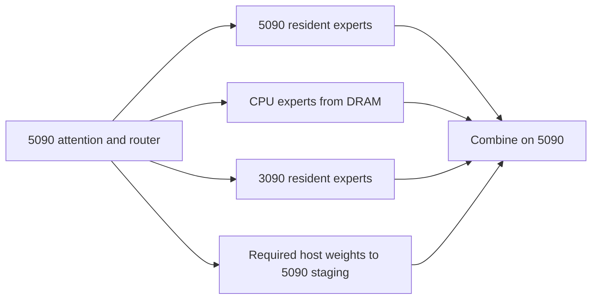

# Proposal 1: cooperative expert execution with arithmetic chosen for each device

Work in **`/home/mdwbr/Infernix-minimax`**, branch `minimax-wsl/proposal-1`: the
independent fork of local Infernix's cooperative runtime assigned to this proposal.
The [central plan](README.md) owns its source provenance, current status and shared
weight location. The original GLM checkout is a read-only donor.
Keep the target's attention, shared experts and output head on the 5090; distribute
routed-expert work among the 5090 cache, the 3090 cache and CPU workers. The central
investment is lowering the cost of requested work and overlapping its service.

The selected weights are the official MiniMaxAI/MiniMax-M3.1-Flash safetensors:
packed NVFP4 routed experts, MXFP8 dense weights and supplied BF16/F32 tensors,
with the official DSpark companion. All proposals use that same checkpoint;
third-party GGUF/EXL3 quants are historical references.

This is the strongest proposal when the original top-4 experts remain valuable
enough that substituting many of them damages useful behavior. It also supplies
kernels and memory primitives that the other two proposals can reuse. Start with
ordinary top-4 routing as a comparison control, not as a permanent restriction on
later combinations with Proposal 2.

The shared [completion contract](README.md#execution-and-completion) governs this
proposal. Component screens decide further investment; selected production work
continues through the exit evidence below.

## Execution design

The scheduler chooses the CPU/primary split from **joint completion time**, not
GPU utilization. Ready helper experts run concurrently with primary and CPU work.
The 3090 initially remains a resident-expert device: foreground weight uploads over
its x4 link are not assumed profitable. Static/profile-seeded placement is the first
control; introduce dynamic helper replacement only for measured lost reuse.

Choose the fastest expert arithmetic independently on each device: native FP4 on
Blackwell where it pays, efficient SIMD packed-weight kernels on the 9950X3D,
and efficient Ampere packed-weight kernels on the 3090. For the same expert,
activation formats, accumulation, reductions and mathematical approximations
may differ, and outputs need not meet any cross-device agreement tolerance.
CPU and 3090 efficiency is required implementation work. Do not carry GLM's INT64
reconciliation or canonical arithmetic into the MiniMax speed path. Import the
selected checkpoint's codes/scales correctly, then choose compute arithmetic by
complete execution speed and the brief whole-model coherence/tool screen.
Restore precision only where that screen exposes a material problem.

Adapt the inspected CPU decode/dot implementations and the WSL helper's expert
kernels before proposing new kernels. Keep weights packed in persistent storage;
unpack and apply scales within the compute path using bounded workspace, reusing
decoded blocks across columns where useful. Judge the complete gate/up,
activation and down-projection service, including conversion and handoff costs.
Measure single-column decode as well as the chosen narrow window; a favorable
wide-matrix result alone cannot establish efficient interactive decode.

## Existing code to reuse

| Component | Inspected source and intended use |
|---|---|
| Heterogeneous execution and lifecycle | The isolated Infernix base's [helper](../../../Infernix-minimax/src/models/glm5_next/execution/helper.h), [offloaded MoE](../../../Infernix-minimax/src/ops/offloaded_sparse_moe/cuda/moe_layer.cu), [peer worker](../../../Infernix-minimax/src/ops/offloaded_sparse_moe/cpu/peer_executor.cpp), cache/residency and transfer primitives. Extract the useful runtime; do not copy the entire GLM experimental policy set. |
| Original Maya helper comparator | DeepSeek [helper scheduler](../../src/ds4/ds4_model.cu), especially `helper_window`, `helper_loop`, `helper_enqueue`, `helper_answer` and `hr_loop`, and [mapped request kernels](../../src/ds4/ds4_kernels.cu). Compare its window-queued service with Infernix's persistent worker. The Windows MiniMax derivative is not the authority for this design. |
| WSL host access | [SelectiveHostBuffer](../../../Infernix-minimax/src/core/host_memory.h) and its implementation in the isolated base, plus the local allocation evidence. CPU/5090 accessibility and bounded helper refill storage are useful mechanisms, with a new MiniMax-sized memory plan. |
| MiniMax mathematics and serving semantics | Maya [model](../../src/mm3/mm3_model.cu), [kernels](../../src/mm3/mm3_kernels.cu), [DSpark](../../src/mm3/mm3_dspark.cu), tokenizer/template and [frontend](../../serve/frontend.py). |
| Fast CPU NVFP4 service | Basalt [AVX-512 multi-column dot](../../../basalt/src/kernels/cpu/nvfp4_avx512.cpp), which decodes weight blocks once for several columns; compare with Infernix's faster noncanonical routes. Bloomery's [qdot](https://github.com/midagedev/bloomery/blob/main/crates/qdot/src/lib.rs) supplies another inspected NVFP4/INT8 layout and tiled CPU implementation. |
| Additional MiniMax/CPU implementation donor | Bloomery [MiniMax body](https://github.com/midagedev/bloomery/blob/main/crates/gpu-minimaxm3/src/body.rs) and [tier](https://github.com/midagedev/bloomery/blob/main/crates/gpu-minimaxm3/src/tier.rs). Reuse useful layout and service ideas within the assigned Infernix base. |

The local Infernix base is selected for its existing WSL ownership, cooperative
dispatch and measured work on this exact pair. Upstream Infernix and NInfer remain
technical references; they are not alternative bases for this assigned proposal.
Basalt supplies useful Blackwell and CPU optimizations; a source port must account
for the 3090 rather than assume every kernel supports both architectures.

## Substantial work required

1. **Add a real MiniMax model binding.** Implement the 60-layer composition, three
   initial dense MLPs, 57 top-4/128 MoE layers with a shared expert, 6144 hidden
   width, 3072 expert intermediate width, Gemma-style norms, 64Q/4KV attention,
   partial RoPE and sparse index selection in all layers. Reuse Maya's math and
   references; GLM's KDA/MLA/mHC composition is not this model.
2. **Adapt the FFN, not just its registration.** The inspected GLM clamped-FFN
   interface caps hidden width at 4096 and computes a different nonlinearity.
   MiniMax needs SwiGLU-OAI with alpha 1.702, limit 7 and the up-branch offset.
   Extend real tile geometry, scale handling and workspace planning for 6144/3072.
   The inspected peer executor also validates 288 experts per layer and sizes
   mapped outputs for width 4096; adapt those GLM-specific protocol assumptions
   to MiniMax's 128 experts and width 6144.
   Compare a fast mixed-arithmetic group directly. Use a few real inputs for
   focused implementation checks; cross-device expert-output agreement is not a
   criterion. Reuse the short generated answers for the practical quality check.
3. **Bind the selected official checkpoint.** Import the safetensors index,
   packed NVFP4 expert codes, block/global scales, MXFP8 dense weights and supplied
   BF16/F32 tensors. Preserve the native weight semantics; record how the selected
   activation arithmetic uses or replaces the supplied input-scale calibration.
   Import the official DSpark weights and scales as well. Adapt these into an efficient
   selected layout. Use small partial imports for initial kernel tests. A full
   artifact conversion is done once for a retained route and preserves stored
   weight values. Compare execution kernels and activation formats on those
   weights, rather than making a second weight quant an obligatory comparison.
   Do not choose the runtime by existing codecs.
4. **Resize the memory architecture.** The NVFP4 expert geometry implies a
   216.4-GiB payload before auxiliary official scale/record metadata,
   so blindly importing GLM's complete-bank/200-GiB layout fails its own arithmetic.
   Evaluate complete host storage only if the full live ledger leaves physical and
   commit headroom. Otherwise use the existing Maya/Strata exclusive RAM/VRAM
   ownership mechanism for a stable GPU-resident subset, with a bounded exchange
   path for eviction. Every source must exist before its last GPU copy is reused.
   Avoid full FP16 expansion or a second full host copy to accommodate a device
   without native FP4 arithmetic; use packed-weight kernels and bounded workspace.
5. **Recalibrate dispatch under sustained conditions.** Preserve resident/missing
   overlap and successive-transfer overlap. Price CPU service, transfer plus GPU
   computation and helper completion for actual MiniMax record sizes. Use the
   existing warm-link evidence; do not reuse an idle P8 transfer estimate.
6. **Integrate the selected route into Engine and serving.** Own model weights
   outside short-lived request state; expose only the tuning controls needed for
   the experiments at safe boundaries. Bring in the MiniMax template/parser,
   reasoning delimiters, tool streaming, cancellation and prefix continuation.

## Cheapest useful sequence

| Step | Small experiment | Decision it changes |
|---|---|---|
| A | Load selected real NVFP4 experts from early/middle/late layers once; compare complete 5090, CPU and 3090 FFN service at one-column decode and one relevant narrow window, including unpacking, scales and activation conversion. | Which native-FP4, SIMD and Ampere execution paths are efficient enough to retain, or which concrete implementation defect needs repair before judging the architecture. |
| B | Repeat the informative case with actual primary staging and CPU/helper contention, with matched storage. | Whether an isolated arithmetic gain survives complete expert service. |
| C | Port the selected MiniMax path and run the shared two-prompt WSL screen against a same-source ordinary control. | Whether the complete architecture advances warmed C1 speed. |
| D | Test one coherent residency/assignment change motivated by its exposed tail. | Whether more useful cache coverage or a changed CPU/primary split helps; avoid a worker-by-budget grid. |
| E | Reuse DSpark with the shared Fast-HSD acceptance policy at a promising width, with all capacity costs included and target temperature 1/top-p 0.95. | Select its configuration and measure the combined benefit. It may follow the initial cooperative screen, but the selected DSpark/Fast-HSD integration remains required for delivery. |

The partial-layer collection should stay loaded through A/B variants. For full
requests, retain one model and device pools across policy changes. Startup-fixed
arithmetic or representations can be compared through compiled runtime dispatch
where safe; otherwise use serial loads and keep compatible host backing.

## What would make it win or lose

Native NVFP4 offers faster hardware arithmetic but larger weight service. At a
22-decimal-GB helper weight budget, a payload-only NVFP4 calculation fits about
690 full experts; the observed EXL3 profile held 884. Actual packing and scratch
determine the final counts. Thus a kernel win can lose through reduced coverage.

Advance when the complete warm requests improve and stay coherent, with useful
helper work and no hidden SSD dependence. If the host/missing-expert tail remains
dominant after a credible fast kernel and dispatch implementation, prioritize
Proposal 2's avoided work or Proposal 3's reuse. A small component win alone does
not justify porting an entire engine. A broken shape/layout import needs repair
before drawing an architectural conclusion.

## Exit evidence

For a retained cooperative design, the actual server must execute the selected
CPU, 5090-resident/staged and 3090 paths with real MiniMax expert records and its
decode/verification widths. Establish complete FFN service, actual assignment and
handoff, selected-only allocations, record lifetime and intended overlap. A dot
product benchmark or linked helper class cannot substitute for those behaviors.
Finish the selected routing and DSpark/Fast-HSD composition, serving/streaming and
the shared short warmed comparison. Each device uses its fastest selected arithmetic;
cross-device expert-output equivalence is not an exit condition.

A supported negative can reject this cooperative arrangement while retaining
useful kernels for another proposal. It does not close the other required decisions
or final integration. The [local GLM evidence](evidence.md#e2-results-already-recorded-on-this-computer)
supports primitives, not a transferable MiniMax rate. Broad quality and long-context
claims remain deferred.
