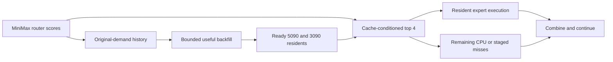

# Proposal 2: cache-aware routing to avoid expensive expert service

Work in **`/home/mdwbr/project-maya`**, branch `minimax-wsl/proposal-2`, using the
owner's Maya fork. The [central plan](README.md) in this checkout owns requirements,
current status and the shared weight location for all three bases.
Build on Maya's MiniMax execution engine in WSL, adapting a helper from the
original Maya DeepSeek V4.1 implementation or our local Infernix WSL implementation.
Import the actual Strata and FOMOE routing mechanisms, adapted to MiniMax's router.
The principal speed gain comes from changing which experts run so that more
useful work is served by already-resident weights.

Use the selected official MiniMaxAI/MiniMax-M3.1-Flash checkpoint throughout.
Maya needs safetensors loading for NVFP4 experts and their block/global scales,
the native MXFP8 dense/draft formats and supplied BF16/F32 tensors, plus efficient
token/window kernels on the CPU and both GPUs. Reuse the relevant Infernix, Basalt and original Maya
mechanisms; the old EXL3-only MiniMax helper is not a loading shortcut. Preserve
the supplied weight values when adapting layouts. Choose the fastest compute
arithmetic independently on each device; the same expert's outputs need not be
numerically equivalent across the CPU, 5090 and 3090.

The owner identifies the Windows MiniMax helper as a rough port of the upstream
Maya DeepSeek helper. It is experimental evidence and an optional comparison
artifact, not the preferred implementation donor. Review the original scheduling,
publication and memory design before selecting the parts to adapt; existing
MiniMax wiring alone does not settle that choice.

This is the first proposal I would screen. Existing local measurements show a
large CPU-expert tail and a large gain from better placement. The user has now
explicitly allowed the next step: exchanging a lower-ranked expensive expert for
a sufficiently plausible cached alternative. The resulting engine is an
approximate model, and its outputs need not match ordinary top-4 execution.

The shared [completion contract](README.md#execution-and-completion) governs this
proposal. A routing policy or promising short screen is intermediate work until
the retained design meets the exit evidence below.

## Execution design

The 5090 retains attention, shared experts and the head. The 3090 supplies a
complementary expert cache and computes its selected records through the worker
selected from the original DeepSeek and WSL Infernix designs. CPU and primary
staging remain available when a good substitute
does not exist. A RAM-resident expert is not treated as a free hit: FOMOE's
original three-tier interpretation must be adapted to this machine's CPU/PCIe
service costs.

Only completed resident records are eligible. A loading destination is not a
substitute until publication. Freeze the ready-set view for the relevant execution
pass to protect readers; this is an ownership rule, not a promise of deterministic
outputs across different cache histories or machines.

## Existing implementations to reuse

| Donor | Actual code inspected | Use and important adaptation |
|---|---|---|
| Strata bounded substitution | [native_router.cu](https://github.com/Niko1221/Strata/blob/main/src/kernels/cuda/native_router.cu), `route_resident_k` / `native_route_resident` | Warp-wide search for a missing selected expert's best resident replacement within a score margin; selected-rank controls and counters. Replace Qwen's 512/top-10 softmax assumptions with MiniMax's 128/top-4 sigmoid router. |
| Strata cache prior | [route_prior.cu](https://github.com/Niko1221/Strata/blob/main/src/kernels/cuda/route_prior.cu) and [verify.cpp](https://github.com/Niko1221/Strata/blob/main/src/core/verify.cpp) | A residency bonus affects selection while mixture weights come from the original router probabilities. Use this as an alternative policy, not an additional bonus stacked blindly on substitution. |
| FOMOE CAR | [car.c](https://github.com/pmerolla/fomoe/blob/main/src/car.c), `car_evaluate`; its active calls/backfill in [gpu_kernels.hip](https://github.com/pmerolla/fomoe/blob/main/src/gpu_kernels.hip) | Score-ratio candidates, no duplicate selection, substitution budgets, protected layers and optional damping. Its CPU-side policy is a clear small reference; use Strata's warp implementation pattern for the hot CUDA path. |
| BigMoeOnEdge substitution | [`RouterHook::apply_substitute`](https://github.com/Helldez/BigMoeOnEdge/blob/cb78bfe0f1218ab350a1b7bcd3945c45eaf94595/core/src/moe/router_hook.cpp) and [measurement notes](https://github.com/Helldez/BigMoeOnEdge/blob/cb78bfe0f1218ab350a1b7bcd3945c45eaf94595/docs/cache-aware-substitution.md) | A residency bonus scaled by the current token's score range, followed by top-k reranking with the same expert count. Read the actual selection scores, including architecture-specific bias/masking. This is an additional reference for the cache-prior arm; its RAM/flash cache and host callback are not the selected CUDA execution design. |
| FOMOE recovery of real demand | The original-choice capture and background backfill around those calls | Keep the experts the unmodified router wanted eligible for future residency, so substitution does not permanently lock the cache into its own choices. Adapt the selected original DeepSeek/Infernix refill machinery instead of importing an NVMe subsystem. |
| Original Maya DeepSeek helper | [ds4_model.cu](../../src/ds4/ds4_model.cu): `helper_window`, `helper_loop`, `helper_enqueue`, `helper_answer`, `hr_loop`; [ds4_kernels.cu](../../src/ds4/ds4_kernels.cu): `helper_take_kernel` | Window-wide ordered enqueue, mapped request consumption, grouped multi-token expert service and completion publication. Recent-slot refills are a separate format-dependent path; EXL3 currently permits the static pool only. Adapt the required mechanisms to MiniMax rather than assuming every feature is active together. |
| Local Infernix WSL helper | [PeerExpertExecutor](../../../Infernix-glm5-local/src/ops/offloaded_sparse_moe/cpu/peer_executor.cpp), [helper ownership/refill](../../../Infernix-glm5-local/src/models/glm5_next/execution/helper.h), host-memory primitives | Persistent worker and direct device publication, with existing WSL resource work. Adapt GLM-specific shapes/protocols and omit its exact-arithmetic requirement for this project. |
| MiniMax integration and historical derivative | [Maya router/model](../../src/mm3/mm3_kernels.cu) and [Windows port notes](/mnt/c/Users/mdwbr/project-maya/docs/MINIMAX_HELPER.md) | Reuse MiniMax math, saved profile and allocation/calibration observations where applicable. Preserve the Windows port and its results without automatically carrying its wrapper or scheduling decisions into WSL. |

These are existing implementations, not a new routing algorithm justified only by
a paper. Preserve source attribution and applicable notices when adapting them.
The [cache-conditional routing paper](https://arxiv.org/html/2412.00099v2) supports
the mechanism; its reported quality and speed do not establish MiniMax behavior.

## MiniMax-specific routing rules

Maya's inspected router ranks experts with `sigmoid(logit) + correction_bias`.
It forms mixture weights from the **unbiased sigmoid values**, renormalizes the
selected set, and the model applies its routed scaling factor of 2.0. Keep those
roles distinct when importing a cache bonus or substitution rule. Copying
Strata's softmax formula unchanged would implement a different, unintended change.

For the first source-derived candidate, keep four executed experts but allow
substitution in the lower two selected ranks. Search a bounded high-ranked
candidate set, initially the original top eight, for ready 5090/3090 alternatives.
Use FOMOE's score-ratio/budget machinery and Strata's warp search. This is an
aggressive starting group relative to preserving all four choices; use the small
coherence/tool screen and tighten the margin, budget or eligible ranks only when
necessary. The exact numeric threshold must be chosen in the MiniMax sigmoid
score domain; Qwen's logit bonus and FOMOE's published threshold are not universal.

Compare a cache-prior reranking arm if bounded substitution leaves material misses
or large candidate-search overhead. Do not run a Cartesian sweep over thresholds,
ranks, protected layers, cache sizes and quantizations. Start from one coherent
candidate and a routing-off control, then make the next change answer a specific
question raised by the result.

## Cache and placement behavior

Maintain separate counts for original router demand, executed expert choices,
substitutions and subsequent useful backfills. Original demand supplies a route
out of a self-reinforcing cached subset. The existing EXL3 profile can supply an
initial placement hint if layer/expert identities match, but its measured coverage
does not transfer to NVFP4. Update from the short live NVFP4 conditioning requests;
a separate profile-training campaign is not a prerequisite.

Price residency by exposed service saved, including whether the 3090 finishes
before the CPU/primary branch. A helper-resident replacement is attractive only if
its computation/transport is useful; do not maximize a combined hit-rate counter
while overloading the helper. Initially give primary/helper readiness fixed
source-derived treatment. Add a device-cost adjustment only if measurements show
that imbalance materially limits the candidate.

Background recovery must remain bounded and must not recreate all the avoided
foreground traffic immediately. Backfill high-value original choices using the
existing admission/refill machinery and charge its actual contention. Preserve
resident bytes until replacement needs them and readers have retired. Adapt
retention only for an observed reuse opportunity; a wholesale cache rewrite is
not a prerequisite to testing routing.

## Implementation sequence

1. **Select the helper from its original implementations.** Start from the WSL
   Maya checkout. Compare the original DeepSeek window queue/mapped handoff with
   Infernix's persistent/direct-dispatch worker at the MiniMax geometry and
   intended memory budget. Use source evidence first and one focused resident
   service comparison if a material choice remains. Adapt the stronger design;
   porting the Windows derivative is not a prerequisite. Retain its source,
   saved profile and measurements, and reuse individual allocation/calibration
   ideas only where they remain applicable. Bind the official NVFP4/MXFP8 weights
   and scale semantics to the MiniMax model, drafter and selected worker. Reuse Proposal 1's
   efficient CPU/3090 packed-weight paths and focused service measurements, then
   establish one short WSL control. The routing comparison must price avoided
   work against credible efficient expert service. No EXL3 baseline run, large
   allocation sweep or Windows rerun is needed.
2. **Make the routing policies selectable in a resident process.** Add a compact
   per-pass policy snapshot and ready-resident lookup. The existing Strata flags
   are read once; simply changing environment variables between requests would
   not compare the intended modes. Keep zero-policy routing available in the same
   executable and reset request/policy history under declared conditioning.
3. **Port the two relevant routing mechanisms.** Begin with bounded substitution.
   Check valid distinct IDs, original-score weighting, unavailable-record exclusion
   and zero-policy behavior on a few real score vectors. Then run the two-prompt
   complete speed/coherence screen. Inspect actual substitution frequency, removed
   CPU jobs/uploads and last-finishing branch.
4. **Restore useful missing demand.** Integrate bounded original-demand backfill,
   using existing workers and completed-publication rules. Compare it as a group
   with routing if preventing drift and following topic changes require it; do not
   demand that every contributor win alone.
5. **Improve the remaining bottleneck.** If misses still dominate, adjust the
   source-derived routing policy or placement. If resident compute dominates,
   apply further kernel improvements justified by the measured tail. Integrate the
   selected DSpark/Fast-HSD policy and measure its interaction with the resident set
   at one promising width, charging its full cost. Its placement in this sequence
   does not make it optional delivery work. Keep target temperature 1/top-p 0.95
   and weight precision above the agreed approximate floor.
6. **Deliver usable tool streaming.** Reuse Maya's `MinimaxRewriter`/`OutputParser`
   and Strata's [frontend recovery](https://github.com/Niko1221/Strata/blob/main/serve/frontend.py).
   Preserve string values and declared names. Report the small tool-loop result
   with local repairs and model retries counted in latency.

## Fast decisions and rollback

The first decisive experiment is a paired, resident routing-off versus
routing-plus-recovery comparison on two short prompts. It answers whether avoiding
expert service changes end-to-end speed at all. A score replay can choose the
first threshold, but it cannot establish a gain because substitutions change later
hidden states and routes. Do not build a perfect simulator first.

Roll back the strongest offending control if the speed answers become incoherent
or the tiny tool workflow repeatedly fails: lower the substitution budget, narrow
eligible ranks, protect affected layers, or reduce the bonus. Restore activation
or KV precision only if that is the changed boundary implicated by the observation.
Keep a coherent faster candidate rather than requiring full-model bit identity.

The principal adverse evidence is real: Strata's stronger cache-prior default was
withdrawn after repetition and weaker agent results, despite positive short speed
tests. FOMOE also identifies cache drift without backfill. These justify quick
inspection and a short changed-topic/return case now, while long-session tests
remain later work as requested. They do not justify a large quality benchmark gate.

With DSpark, apply Fast-HSD acceptance against the **selected approximate target**
using target temperature 1/top-p 0.95. Relaxed acceptance intentionally changes the
output distribution even relative to that target. Verification does
not restore the original top-4 model. Keep cache-policy publication and discarded
speculative state explicit, and do not claim invariance across window widths.

This proposal wins if the complete, lightly screened coding/agent flow is faster
after backfill, helper service and repairs are charged. It loses its main advantage
if usable substitution margins remove little exposed work, or quality rollback
restores almost all original misses. Its deliverable is a resident WSL engine with
observable routing controls and a fast coherent operating point, not a claim that
the approximation is quality-equivalent in every task.

## Exit evidence

For the retained routing design, the public server must actually change executed
expert IDs using model scores and ready 5090/3090 residency. Establish valid distinct
choices, selected-set weighting, readiness/lifetime handling and the selected
original-demand/backfill behavior. Record substitutions and resulting CPU service,
transfers and complete request cost; an offline hit-rate gain or an unused policy
object cannot close this work. Use the changed-topic/return request already in the
shared short protocol when assessing retained-cache behavior.

Complete the efficient expert paths, Fast-HSD integration at temperature 1/top-p
0.95 and usable reasoning/tool streaming in the same selected engine. Compare that
composition through actual serving with matched conditioning and the brief quality
screen. A supported negative closes the named routing policy, not other credible
required strategies; no exact-routing or cross-device numerical agreement is required.
