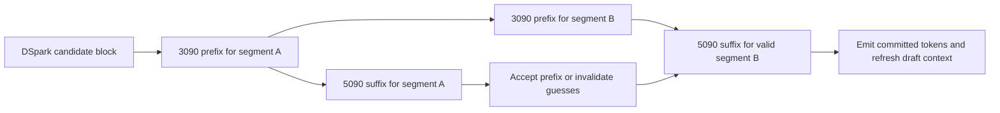

# Proposal 3: speculative windows across a two-stage layer pipeline

Strata is the initial integration home for this strategy, not its only possible
runtime base. Follow the central [base/strategy comparison](README.md#base-choice-and-strategy-combinations)
when evaluating other bases and combinations.
The [locked strategic gates](README.md#strategic-comparison-and-locked-gates)
define the pipeline addition and conditional interaction cases. A loss removes
only the work those rules permit; the complete catalog is not a required sweep.

Work in **`/home/mdwbr/strata`**, branch `minimax-wsl/proposal-3`, using the owner's
Strata fork. The [central plan](README.md) owns current decisions/status and the
shared weight location. Its [pinned Maya donor](../../../strata/reference/maya-minimax/README.md)
provides the model/drafter source for the port.
On restart, the central [repair and corrective-measurement order](README.md#mandatory-restart-order)
comes before new split/composition work; repair and remeasure the still-relevant
existing paths first.
Build around **Strata's layer/window scheduling**, using Maya's MiniMax layers and
five-layer DSpark drafter. The 3090 owns an initial
contiguous layer range; the 5090 owns the remaining layers and target output head.
Each GPU keeps dense weights, KV and expert residents for its own layers. The
principal investment is increasing emitted tokens per expensive expert traversal
and keeping the two devices usefully overlapped for one request.

Use the selected official MiniMaxAI/MiniMax-M3.1-Flash checkpoint for all target
execution and its matching official `dspark/` companion, with the draft
representation recorded separately.
Use Fast-HSD's target-relative cutoff for relaxed acceptance, keeping target
temperature 1 and top-p 0.95. The output distribution may change intentionally.
Import the official safetensors, NVFP4 expert codes/scales, MXFP8 dense/draft
weights and supplied BF16/F32 tensors before full-model tests; comparisons with
third-party GGUF/EXL3 targets are not part of the initial sequence.
Choose the fastest arithmetic for each device and verification width. Moving
an expert or layer between devices imposes no numerical-equivalence requirement;
use the shared brief coherence/tool screen to judge the resulting model behavior.

This is distinct from an expert helper: the 3090 executes whole target layers,
including attention, rather than receiving selected FFNs from all 57 MoE layers.
It is also distinct from tensor parallelism: a stage boundary moves activations,
not a per-projection collective over the 3090's x4 link.

The shared [completion contract](README.md#execution-and-completion) governs this
proposal. A supported negative may close the pipeline arrangement; the selected
DSpark/Fast-HSD integration remains required in the delivered engine.

## Execution design

A plain layer split serializes one token across both cards. This proposal must
create useful work ahead of the current commit, not call that serialization
parallel speedup. First reuse already available positions of a DSpark block:
while the 5090 verifies one segment, the 3090 speculatively computes the prefix of
the next segment. A rejection invalidates the dependent segment and restores its
append frontier. Larger contiguous verification windows are a separate comparison
because they may reuse expert weights better than segmentation.

Do not assume DSpark is Qwen's MTP under another name. Its seven-position block
uses target taps from layers **3, 17, 31, 45 and 59**. Future blocks cannot consume
target taps that have not been computed. The first pipeline therefore stays within
already available draft candidates; the next draft waits for the required target
context. Measure those bubbles. An additional future-window guess is considered
only if its dependencies and likely usefulness are established.

## Existing code to reuse

| Component | Source and adaptation |
|---|---|
| Stage ownership, handoff and speculative windows | The Strata base's [MULTI_GPU.md](../../../strata/docs/MULTI_GPU.md) and actual `--pipeline-windows` implementation in [generate.cpp](../../../strata/src/program/generate.cpp). Reuse stage workers, speculative/committed frontiers, restore and buffer lifetime. Its Qwen-specific state must become MiniMax KV/indexer state. |
| MiniMax and DSpark execution | Pinned Maya [model](../../../strata/reference/maya-minimax/src/mm3/mm3_model.cu), [DSpark](../../../strata/reference/maya-minimax/src/mm3/mm3_dspark.cu), [draft interface](../../../strata/reference/maya-minimax/src/mm3/mm3_dspark.hpp) and [serving loop](../../../strata/reference/maya-minimax/src/mm3/mm3_main.cpp). Ordinary target verification, draft confidence and sampling already exist in the donor; porting them into Strata remains work. |
| Relaxed acceptance | Fast-HSD [`speccascade_accepts`](https://github.com/ZhouYuxuanYX/Fast-HSD/blob/66d0b731ac9e784ffaa2d7cf9b8f7da68ca4bd17/fast_hsd/core/truncation_verification.py) and its active [`_speculative_sampling`](https://github.com/ZhouYuxuanYX/Fast-HSD/blob/66d0b731ac9e784ffaa2d7cf9b8f7da68ca4bd17/transformers/generation/utils.py) path. Adapt the acceptance and replacement-token rules into the selected engine while retaining Maya's target sampler and DSpark drafter. |
| Multi-column expert reuse | Maya's expert grouping/window scheduling, adapted to the selected NVFP4 weights; Basalt [NVFP4 AVX-512 tiles](../../../basalt/src/kernels/cpu/nvfp4_avx512.cpp) and Infernix's GPU paths. Decode a weight block once for its selected token columns. |
| Proposal choice | Basalt [draft policy](../../../basalt/src/spec/draft_policy.cpp) and [suffix drafter](../../../basalt/src/spec/suffix_drafter.cpp). Adapt complete cost observations to DSpark and code/tool repetitions; do not transplant Qwen's priors as MiniMax measurements. |
| WSL transfer/ownership | Local Infernix [staged transfers](../../../Infernix-glm5-local/src/core/staged_device_transfer.cpp) and host memory primitives, with the existing pinned mailbox/stage patterns. Use fresh MiniMax code; this does not resume the held P51 executable or experiment. |

The inspected upstream Strata implementation separates pipeline windows from
peer/helper caches and asynchronous adaptation combinations. The custom MiniMax
module now has an explicitly owned stage/helper path. Reuse that path for the
bounded follow-up, charging its scheduling, scratch, contention and retirement;
the upstream separation is not a prohibition on the implemented combination.

## Fast-HSD acceptance

Use the inspected Fast-HSD implementation as the algorithm donor for the custom
engine. Retain DSpark's existing draft weights; this selection does not require
training a new drafter or adopting Fast-HSD's Python benchmark runtime.

For each position, compute the target distribution `p` at temperature **1** and
top-p **0.95**, conditioned on the committed prefix and preceding accepted drafts.
Accept the proposed token `x` when it is in that top-p support and
`p(x) >= rho * max(p)`. The initial policy parameter is `0 < rho <= 1`; its value
is selected by the short speed/coherence screen. This acceptance parameter is
separate from the target sampler's top-p and min-p settings.

Commit the longest accepted prefix. On the first rejection, discard the dependent
draft suffix and sample a replacement from that position's target distribution
`p`, following Fast-HSD's cutoff path. When the whole block passes, sample the
bonus token from the target distribution after it. The cutoff path uses this
target draw rather than the lossless `max(p-q, 0)` residual draw. Preserve normal
EOS, cancellation and committed-state handling.

Use Maya's existing sampled verification as the experiment control at the same
temperature/top-p. Setting `rho=1` is not that control: a top-1 cutoff still does
not reproduce lossless sampling at temperature 1. Numerical output identity is
not a selection criterion. Keep only useful policy choices after the short test.

DSpark confidence estimates schedule verification work; they are not the target
probabilities used for acceptance. Its existing confidence estimates were trained
for the original acceptance rule. Choose useful verification widths from observed
accepted lengths and complete round cost under the new rule, without making
confidence-head retraining a prerequisite.

## Why it could help, and what could defeat it

Within a layer, group the verification positions by expert and load/decode each
expert record once for all its users. The relevant quantities are:

`missing expert payload per emitted token = fetched bytes for the round / committed tokens`

`emitted throughput = committed tokens / measured complete round wall time`

Include drafting, verification, repair and scheduling in that wall interval.
Follow the shared [generation calibration and timing protocol](README.md#generation-timing-and-expert-cache-conditioning):
prefill and loading stay outside the speed decision, and a fixed suffix-helper
set must be populated from representative generation demand before comparison.
Any suffix-helper path used for R1 must share the
[required helper-only refresh](README.md#required-helper-only-refresh), including
retirement of stage readers and consistent HOST ownership, while its model remains loaded.
Those activities may overlap; do not add overlapping kernel intervals. More proposed or accepted tokens alone is not a
win. If each new candidate brings almost four new uncached experts per MoE layer,
expert-union growth can erase batching gains. That failure has already been
reported for MiniMax on a 5090/EPYC machine, while another MiniMax system reported
large DSpark gains. Both observations are retained in [the evidence note](evidence.md).

The 3090 can use more of its VRAM for residents when it owns fewer layers, but its
attention/dense work is slower and every stage needs workspace. Allocate the
split by actual stage service and coverage, not 30/30 layers or VRAM ratio alone.
Use the existing source placement heuristic as the first choice, then at most one
informed alternative before deciding whether a wider search is worthwhile.

The review identified a concrete smaller-prefix/helper choice under
[R1](README.md#r1-smaller-prefix-and-suffix-helper-decision). Eight prefix layers
contain 640 expert records; four contain 128 and five contain 256, while each
retains target tap 3. Released prefix storage may support substantially more
suffix-helper residency. Reconcile shifted dense/KV/scratch costs, primary cache
displacement, actual helper demand and contention before assigning that capacity.
Choose one informative alternative and resolve it with a sufficient measured
bound or short complete comparison. The eight-layer/25-record helper loss does
not bound this different composition. Current status and evidence remain in the
central plan. No automatic split sweep or duplicate rewrite of shared model
mathematics is required. The central bound contract governs exclusion, and its
base/composition gates govern full-runtime integration in other bases. A loss
under Maya's composition cannot eliminate Strata's independently chosen alternative.

Resolve the material [R4 residency comparison](README.md#r4-evidence-based-architecture-comparison-and-adaptive-primary-residency)
before closing this stage/helper decision. Use the retained efficient residency
behavior in the Maya control and the applicable stage/suffix paths, with actual
capacity and transfer costs. A shared inherited fixed-cache limitation does not
make the broader architecture comparison complete; reuse old results at their
recorded scope and repeat only the affected composition.

## Implementation sequence

1. **Screen block economics before the full stage-runtime port.** Reuse the shared
   MiniMax control once its selected official NVFP4/MXFP8 path works, and keep it loaded.
   Adapt Fast-HSD acceptance and compare it with existing sampled DSpark at one
   useful width, keeping target temperature 1/top-p 0.95. Use the ordinary-decode
   control to establish the full benefit of speculation; add another width only
   if the observed cost/reuse changes the decision. Reuse existing draft weights;
   no training is required. Capture unique missed experts
   per layer/window, committed tokens, draft cost and target time. This determines
   whether wider service is promising and which width deserves pipeline work.
2. **Establish a real partial-stage service path.** Reuse representative real
   MiniMax layers/records, the selected quant and stage-local memory budgets.
   Use efficient CPU and 3090 packed-weight kernels, sharing Proposal 1's
   implementation and focused measurements. Repair identified kernel or
   integration defects before drawing conclusions about the stage architecture.
   Measure the prefix's 3090 service and host-mediated handoff, including CPU
   misses, against 5090 service at the same width. Include cache displacement.
   A tiny all-resident GPU matmul is not a model-stage measurement.
3. **Port the stage runtime and model state.** Assign a contiguous prefix to the
   3090 and suffix/head to the 5090. Own only each stage's selected dense weights,
   KV and experts. Collect all five DSpark taps through explicit handoff buffers.
   Start with one safe serial stage path for comparison, then add overlapped
   segments; do not optimize serial splitting for weeks before testing overlap.
4. **Adapt speculative state handling.** MiniMax has attention KV and sparse block
   index state, not Qwen's GDN recurrent state. Snapshot append frontiers and any
   partially overwritten block/tail. Reuse safe double-buffer/restore patterns;
   avoid copying the full context per round. Rejecting a segment retires its
   writes and dependent work before reuse. Accepted-only publication governs
   user-visible tokens and committed request state.
5. **Place the drafter by exposed cost.** Compare resident DSpark on the primary
   with first-stage/3090 placement only where the resulting overlap can pay.
   Charge tap transport, draft head/embedding duplication or sharing, cache
   displacement and extra workspace. The GLM secondary-MTP outcomes do not
   establish this result: MiniMax's draft is a different five-layer network.
6. **Improve the selected window path.** Group real expert-column jobs, use
   per-device fast arithmetic and the measured CPU split, and consider suffix
   lookup for code edits/tool text through the existing policy. Keep only the
   small number of window/lookup choices the measured costs can distinguish.
7. **Integrate serving and the retained composition.** Preserve token streaming,
   reasoning, tools, cancellation and prompt continuation through the public
   server. If Proposal 2 supplies a useful routing policy, compare pipeline off/on
   with that same policy on both sides; its miss reduction can change the overlap
   opportunity. No exact-output requirement is introduced for the combination.

## Resident test and memory design

Keep stage weights and per-stage expert pools alive through serial-versus-pipeline
comparisons. Allocate the second window's scratch only for the selected pipeline
route; report both the equal-capacity diagnostic and the fully charged comparison
when its allocation displaces useful experts. Keep one drafter loaded for width
comparisons. A true drafter-off control may reclaim its memory and legitimately
need a separate serial load.

Per-stage CPU/GPU-accessible host regions may be useful: each GPU maps the layers
it owns rather than making a large portable bank visible to both contexts. This
is a proposed application of the existing WSL host-memory primitives, not a proven
allocation result. The selected 216.4-GiB NVFP4 expert bank needs the same complete
resource accounting as Proposal 1, potentially with an exclusive RAM/VRAM
complement. Use bounded shared staging where it is cheaper; do not duplicate the
full bank for the two stage owners.

Do not inherit Strata's current WDDM 8-GiB pinning policy as a hardware ceiling.
Conversely, the local large-allocation evidence does not validate an arbitrary
two-device mapping. Check the selected application's actual allocation/access
sequence once; do not repeat the historical synthetic allocation campaign.

## Discriminating experiments and stopping decisions

| Observation | Response |
|---|---|
| Moderate windows reduce complete time per emitted token and fetch fewer bytes per emitted token | Develop grouped verification and the two-stage overlap candidate. |
| Wider windows lose because nearly every candidate adds uncached experts | Try one reuse-improving composition with the selected cache-aware router or a shorter window; do not perform an automatic width sweep. |
| 3090 stage service plus handoff cannot compete at credible cache capacities | Keep the one-primary grouped verifier, and stop the current split candidate unless a named capacity/overlap change can reverse it. |
| Stage service is useful, but speculative segments are frequently discarded | Tighten the existing confidence/admission rule or stop that pipeline depth. Preserve the ordinary DSpark result. |
| Two stages repeatedly contend for the same CPU/DRAM service | Compare one explicit CPU/transfer allocation change; a free-overlap timing model is insufficient. |

A serial split loss alone does not reject useful pipeline overlap, but the earlier
local Qwen stage losses prevent assuming that a second card helps merely by
holding layers. NVIDIA pipeline operation is opt-in in the inspected Strata
source; its favorable AMD/Intel defaults are not qualification of this pair.

## Exit evidence

The first full-model decision uses the common two-prompt screen with the weights
resident; the retained combination receives the small four-request follow-up.
Quality checks reuse those outputs and a tiny tool loop. A retained pipeline needs
observed stage execution and useful overlap, all five target taps, correct committed
frontiers after rejection/cancellation, and the actual memory/cache displacement
charged to the comparison. Acceptance rate, isolated stage timing or a serial split
does not establish a pipeline gain.

For the retained state path, exercise an early rejection and subsequent
continuation/prefix reuse, including affected EOS/output-limit and cancellation
boundaries. Check real production frontiers and reader retirement; callback
decisions alone do not establish target/DSpark state validity. Follow the shared
[R3 closure](README.md#r3-speculative-state-verification) and apply R2's submission
and retirement fixes to any copied paths used for the new comparison.

Deliver DSpark/Fast-HSD through the actual server at target temperature 1/top-p
0.95, with the cutoff, replacement-token behavior and committed/discarded work
observable. Exercise the affected request-state and streaming behavior and measure
complete emitted-token throughput. If the pipeline is defensibly rejected, finish
this required integration in the selected engine and retain useful window kernels;
do not label the overall plan complete while other required work remains. There
is no lossless-output or cross-device arithmetic-equivalence gate. Long-context
behavior remains later work.
